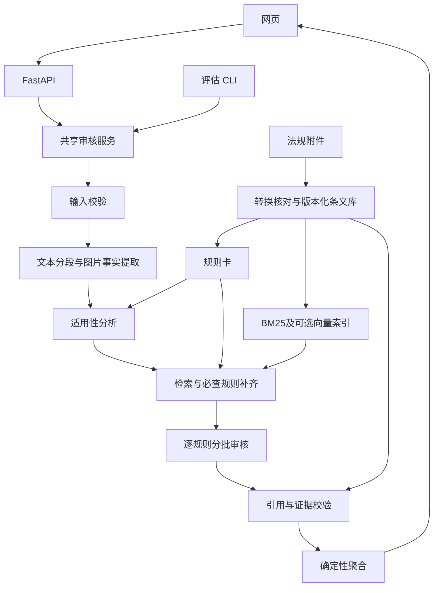

# 保险营销内容智能审核实施规格

版本：v1.1（合并版）  
日期：2026-10-11  
实施状态：待实施  
来源：SPEC_01、SPEC_02 及本次合并决策。

本文件作为后续实施主规格；两份原规格保留为历史参考，冲突以本文件为准。本文件不代表代码、法规解析、模型调用、人工标注或评估已完成。

## 1. 目标与实施边界

实现本地可运行的保险营销内容审核 demo：

- 输入中文文本，或最多 5 张有序图片及配文。
- 使用百炼 API，输出审核结论、违规类型、理由、材料证据、条文编号及原文。
- 交付网页演示、JSON 导出、评估模块及实际报告、架构说明、README 和 HANDOFF。

MVP 不实现视频、微调、自动发布、生产权限平台、真实资质查询或自主规划 Agent。

合并决策：

| 项目 | 最终选择 |
|---|---|
| 总体架构 | SPEC_01 的固定工作流 |
| 审核结论 | 合规／违规／需复核，技术失败单独处理 |
| 知识库 | 原文、检索块、规则卡分离，版本化管理 |
| 检索 | 默认 BM25；向量 + BM25 + RRF 为可选增强 |
| 审核完整性 | 适用性分析 + 必查规则覆盖补齐 |
| 证据 | 区分文字、视觉观察和缺失型证据 |
| 最终判定 | 程序确定性聚合 |
| 置信度 | 逐项模型自评，可为空；不合成整体概率 |
| 演示 | FastAPI 托管 HTML/CSS/JavaScript |
| 评估 | 固定测试集、三分类、覆盖率、引用质量、技术失败及性能 |

不采用“存疑则合规”、无有效引用仍保留违规、图片失败后仅审文本却输出整体合规。

## 2. 法规来源与版本

当前实施规则集按用户确认，使用用户提供在 `法律法规/` 中的现行正式文本；建立独立快照规则集，不与原 Spec_01 的题目附件草案混用。网络营销办法 PDF 已是核心来源；《中华人民共和国保险法.doc》作为后续扩展来源登记；按用户要求暂缓抽取，不纳入当前三份核心法规快照：

```text
ruleset_id = official-v1-2026-10-11
ruleset_mode = official_snapshot
```

本次候选规则集来源：

1. `法律法规/保险销售行为管理办法.doc`
2. `法律法规/金融产品网络营销管理办法.pdf`
3. `法律法规/互联网保险业务监管办法.doc`
扩展来源：`法律法规/中华人民共和国保险法.doc`（用户指定已生效版本；抽取暂缓，未来完成核对后建立新规则集）。

- **《保险销售行为管理办法》**：国家金融监督管理总局令 2023 年第 2 号公布，自 2024 年 3 月 1 日施行。官方来源：[金融监管总局规章页](https://www.nfra.gov.cn/cn/view/pages/rulesDetail.html?docId=1129945)。
- **《金融产品网络营销管理办法》**：中国人民银行等八部门公告〔2026〕第 9 号，2026 年 4 月 21 日成文，2026 年 9 月 30 日施行。本地 PDF 的原始字节和 SHA-256 是该快照依据。官方公告：[市场监管总局公告页](https://www.samr.gov.cn/ggjgs/tzgg/art/2026/art_45df2e4c27674b2c82b9a5b4489b64ad.html)。
- **《互联网保险业务监管办法》**：中国银保监会令〔2020〕第 13 号公布，自 2021 年 2 月 1 日施行，2015 年暂行办法同时废止。官方来源：[金融监管总局文件页](https://www.nfra.gov.cn/cn/view/pages/ItemDetail.html?docId=949137)。

以上版本元数据须记录在知识库并以文件、原文及权威来源交叉核对。附件缺失、损坏或解析失败时，阻止知识库发布。

保险法以本地文件字节及版本标识为本项目依据。官方来源仅用于核对版本、现行状态及抽样原文，不替换用户文件。后续公开征求意见稿、尚未生效文件仅作为 `draft` / `reference_only` 单独记录，不得参与现行规则集裁决；只有正式公布并达到生效日期，且完成条文核验、规则映射和评估后，才可进入新正式规则集。

### 2.1 规则集扩展与版本生命周期

法规来源登记与规则集组成分离：`data/sources/catalog.json` 保存候选来源元数据，`ruleset manifest` 明确每个不可变快照包含哪些 document/version/hash 及有效日期。当前目录清单已包括本地《中华人民共和国保险法.doc》；它按用户指示暂缓，不属于当前快照；当前三份核心来源完成核对即可通过 P0。保险法后续完成抽取和跨法规映射后另建新快照，不原位补入已发布版本。网络营销办法 PDF 已包含，不重复导入。仅把文件放入 `法律法规/` 不会自动进入审核，需登记来源、确认状态和适用范围后显式加入规则集，避免新草案、重复文本或无关文件被自动当作依据。

任何已发布规则集不可原位覆盖。新增法规、修订文本、生效状态变化或经核实的更正都生成新 `ruleset_id`，保留旧快照以支持历史复现；允许多个正式集并行（例如当前版与指定历史版）。采用“来源登记 → 状态及效力核验 → 原文抽取 → 条款级切分及定位 → rule_card 映射/冲突审查 → 候选快照构建 → 自动校验与回归评估 → 显式发布”的更新流程。版本升级时重建受影响文档条文及映射，运行语料校验并复核已有评估集以及新规则专项样本；未通过前旧版仍是当前可用规则集，新版保持候选状态。新法规不会仅因文件出现或发布日期较新就自动启用。

条文引用 ID 使用 `document_id + document_version + article_no + sub_item`；条文内容改变时通过 `text_sha256` 识别，不复用被改写原文的校验状态。规则卡含 `document_status`、`valid_from`、`valid_to`、适用条件、例外、来源类型和核验状态；检索先按本次固定规则集和审核日期过滤，再结合营销材料事实判适用性。跨文件冲突需记录优先级或人工复核，不能靠检索分数决定适用法。

《中华人民共和国保险法（修订草案征求意见稿）》属于草案，不替换用户提供的现行法文本；本项目当前不将网页草案加入裁决语料。

页面和结果标注：

> 正式规则快照：official-v1-2026-10-11。审核结论仅覆盖列出的规则文件及提交材料范围。

保留原附件，计算 SHA-256。旧 `.doc` 优先用可用的 LibreOffice headless 转换，记录版本、命令及转换产物。不得使用模型记忆补全文。

核对首尾、章节、条号、款项和原文完整性。条数只能辅助诊断，不能代替原文核对。

## 3. 架构与技术方案



| 模块 | 选型 |
|---|---|
| 运行时 | Python 3.11+，锁定依赖 |
| API／契约 | FastAPI、Pydantic |
| 页面 | HTML/CSS/JavaScript |
| 模型接口 | OpenAI 兼容客户端连接百炼 |
| 文本／视觉模型 | 候选 qwen-plus／qwen-vl-plus，实施时验证 |
| 默认检索 | 中文分词 + BM25 |
| 可选增强 | 百炼 Embedding + FAISS + RRF |
| 数据存储 | JSONL；运行元数据可用 SQLite |
| 测试与评估 | pytest、项目 CLI |

模型、地域、Base URL、结构化输出能力及 Embedding 维度必须实际验证。JSON mode 不等于严格 Schema，始终执行 Pydantic 校验。

MVP 不默认引入 PaddleOCR；未来启用时应单独记录提取器版本、错误和评估结果。

## 4. 结论、执行状态与聚合

### 4.1 业务结论

| decision | is_compliant | 含义 |
|---|---|---|
| compliant | `"yes"` | 当前范围内全部适用检查完成，无违规、无阻断项 |
| non_compliant | `"no"` | 至少一项明确违规通过引用、证据和条件校验 |
| needs_review | `null` | 无有效明确违规，但材料或条件不足以完成判断 |

技术失败时，`decision` 和 `is_compliant` 均为 `null`，通过执行状态与需复核区分。

可自动判定样本满足 yes/no 要求；需复核作为明确标注的扩展状态，不映射成合规。

### 4.2 阻断项

阻断项指：**与当前审核有关，尚未解决，且可能改变规则适用性或结论的条件。**

包括：

- 关键文字不可读。
- 必要图片未成功提取。
- 判断缺失披露时，材料完整性不明确。
- 主体、产品或渠道未知，影响规则适用。
- 已触发的具体规则依赖必要外部事实，但缺少证据。

边界：

- 未展示资质不等于无资质。
- 不因所有机构都涉及资质就让所有请求进入复核。
- 内部制度、与当前材料无关的外部事项记为范围外，不阻断内容结论，也不得宣称已通过。
- 非关键区域不可读可以仅提示，但必须记录其不影响判断的理由。
- 用户声明保留来源，不作为外部验证事实。

### 4.3 部分失败

`status` 使用 `completed / partial / failed`，与业务结论独立。

| 情况 | status | decision |
|---|---|---|
| 检查完成，有有效违规 | completed | non_compliant |
| 检查完成，无有效违规，但存在材料／条件阻断项 | completed | needs_review |
| 检查完成，无违规、无阻断项 | completed | compliant |
| 有有效违规，但其他阶段或批次技术失败 | partial | non_compliant |
| 存在技术失败，且无有效违规可支持结论 | failed | null |

`partial` 返回已验证违规、失败项和覆盖信息，页面显示“已发现违规，审核未完成”。

`failed` 不生成业务结论，不把网络、鉴权、无效模型输出等问题包装为需复核。

## 5. 知识库与规则契约

统一存放于：

```text
data/corpus/official-v1-2026-10-11/
```

| 文件 | 核心内容 |
|---|---|
| manifest.json | 规则集、语料／规则／索引哈希、构建版本、验证状态 |
| documents.jsonl | 文档 ID、标题、来源、SHA-256、来源类型、效力状态、公布/生效/修订日期、有效期、官方核对来源、提取方式 |
| `data/sources/catalog.json` | 来源元数据与规则集成员意图；新文件必须显式登记并标注 include / reference_only / excluded 与原因 |
| `data/extracted/extraction-registry.json` | 集中登记每个来源的路径/哈希、抽取工具/版本、产物/哈希、抽取尝试、结构/法律核验状态、关联条数及语料产物哈希；由 `build_extraction_registry.py` 汇总生成 |
| articles.jsonl | 稳定条文 ID、条号、章节、原文、规范化文本、来源定位 |
| chunks.jsonl | 检索块 ID、父条文 ID、款项定位、文本、标签、关键词 |
| rule_cards.jsonl | 规则 ID、条文关联、分类、适用范围、条件、例外、所需事实、可审核范围 |

`checkability`：

```text
content_checkable
context_required
external_verification
out_of_scope
```

规则卡是解释，正式引用只能来自条文原文。目录中新增文件不得被 glob 自动纳入；由维护者登记、审核状态并构建候选快照。来源数量不限于当前四份。

切块必须保留父条、适用条件和例外。不能因长条拆分而只保留禁止行为、丢失前提。

候选分类参考两份原规格，包括收益承诺、误导比较、产品混淆、披露、资质授权、监管名义、渠道、适当性和合同一致性。

**分类必须以核对后的附件为准，允许增补、合并、删除或停用。** `OTHER_VIOLATION` 仍须有有效规则和证据，不能用来容纳校验失败结果。

## 6. 工作流

### W1 输入校验

- 文本最多 10,000 Unicode 码点。
- 图片 0～5 张；文字、图片至少一种。
- JPEG／PNG／WebP。
- 单张不超过 10 MB，总计不超过 25 MB。
- 解码后单张不超过 20 MP。
- 检查实际类型、解码结果及资源限制。
- 超限返回错误，不静默截断。

HTTP 接口只接受上传文件，不接受任意本地路径或远程图片 URL。评估 CLI 可读取指定评估目录中的图片。

### W2 图文事实提取

逐图保留：

```text
image_id
visible_text
text_blocks[]
visual_observations[]
unreadable_regions[]
extraction_warnings[]
extractor / model_id
```

按上传顺序保存 ID。文字和视觉观察分开，不能猜人物身份或资质，不能补全不可读文字。

无可靠坐标时只定位图片和文本块。图文矛盾保留双方证据。

图片服务失败按技术失败处理；提取成功但关键区域不可读按材料不足处理。

证据出现在 OCR 文本中，只证明引用与提取结果一致，不证明 OCR 与原图一致。评估中单独检查提取错误。

### W3 适用性与审核计划

分析商业营销属性、保险属性、渠道、发布主体、产品、材料完整性及未知条件。

针对**已发布规则全集**建立审核计划，而不是仅针对检索到的规则。

- 排除规则必须记录理由及事实来源。
- 未知不能直接视为不适用。
- 标记必查规则、条件待定规则、必要外部核验及范围外规则。
- 全部规则最终进入执行台账；遗漏视为覆盖缺口。

### W4 检索与覆盖补齐

按主张、文本段／图片、分类、产品和主体构造查询，不仅使用材料前 512 字。

默认：

1. BM25 每个查询候选 Top 8。
2. 按 ID 去重。
3. 补父条、定义、适用范围和例外。
4. 加入全部必查规则，以及解决适用性待定所需条文。

可选 hybrid：

1. 向量 Top 8 与 BM25 Top 8 合并。
2. RRF 融合，默认 `k=60`。
3. 每个查询保留 Top 8 候选。
4. 执行与默认方案相同的覆盖补齐。

标签加权默认关闭；只有开发集验证后才启用。

超上下文按规则分批，保留所需证据和关联条文，不静默截规则或材料。

### W5 模型审核

输入包含规则版本、事实来源、条文原文、规则条件和例外、少样本及 Schema。

待审营销内容属于数据，不能修改审核规则。

逐规则输出：

```text
rule_id
applicability
condition_results[]
evidence_ids[]
finding: violation / no_violation / uncertain
reason
model_confidence
missing_facts[]
```

模型不生成最终业务结论。理由为简短的证据—条件—条文说明。

少样本覆盖否定、引用、教育语境、保证与非保证利益、局部材料及多图补充，并与开发／测试数据隔离。

输出 token 预算随批次配置，检测截断和遗漏规则。

### W6 引用与证据校验

检查：

- Schema、枚举、规则归属。
- 引用 ID 属于本次允许引用集。
- 条文真实存在。
- 证据 ID、文字范围有效。
- 条件未知却被强判。
- 外部事实编造。
- 重复发现和遗漏规则。

标题、条号、原文由程序回填。

格式／结构修复每批最多一次，受整体预算限制；仍失败记为技术失败。不得保留无依据违规或将其改名为 OTHER。

证据分两类：

| 类型 | 内容 |
|---|---|
| present | source_type、source_id、quote、start/end、image_id/block_id |
| absence | inspected_source_ids、required_disclosure、material_completeness 及来源、search_scope、reason |

缺失型违规不能编造一段不存在的引用。只有适用义务与材料完整性条件成立，才可判定披露缺失。

文字偏移采用 Unicode 码点、左闭右开；前端按码点处理。

### W7 聚合、覆盖与置信度

逐规则台账状态：

```text
checked
not_applicable
needs_context
external_verification_required
failed
out_of_scope
```

`checked` 的 finding 仍可能是 `uncertain`。

覆盖分母：

```text
eligible = 全部规则 - 有依据的 not_applicable - out_of_scope

coverage_ratio = checked / eligible
resolved_ratio = checked 且 finding 非 uncertain / eligible
```

分母为零时比率为 `null`。条件未知及必要外部核验仍进入分母。

这两个比率是执行统计，不是正确率。不能仅凭覆盖率 100% 判合规。

合规必须满足：无台账遗漏、无技术失败、无阻断项、全部适用内容检查完成且无违规。

逐项置信度可为模型自评：

```text
confidence_kind = model_self_report
```

明确未经校准、不是正确率。顶层：

```text
confidence = null
confidence_kind = not_computed
```

MVP 不生成整体概率，不使用 SPEC_02 的加权公式。

## 7. API 与页面

共享服务：

```python
async def review(request: AuditRequest) -> AuditResponse: ...
```

API 和评估复用服务；评估无须启动 HTTP。另设 API 集成测试。

审核入口：

```text
POST /api/v1/audits
multipart/form-data:
  text
  images[]
  context
```

context 包含 channel、publisher_type、product_type、material_completeness，默认 `unknown`，枚举集中定义。

响应包含：

```text
audit_id、trace_id、status、decision、is_compliant、summary
ruleset_id、ruleset_mode
violations[]、review_items[]
coverage
confidence、confidence_kind
warnings[]、errors[]
```

- violation：类别、理由、证据、引用、逐项置信度。
- review_item：关联规则、类型、原因、是否阻断、所需信息。
- coverage：逐规则状态及原因、总数、eligible 数、checked 数、覆盖与解决比率。
- errors：阶段、关联规则／图片、错误码、可否重试、脱敏说明。

其他接口：

```text
GET /healthz
GET /readyz
GET /api/v1/rulesets/current
GET /api/v1/articles/{article_id}
```

readyz 不每次付费调用模型；条文接口只允许访问当前知识库 ID。

错误状态：413 输入过大、415 格式不支持、422 参数无效、502 模型输出不可用、503 服务／语料不可用、504 整体超时。

页面必须展示规则版本、三态结果、执行状态、违规、待核验、覆盖、失败项、证据与原文、JSON 下载。`partial`／`failed` 显著提示。

失败保留输入，提交禁重复点击。用户与模型文本按纯文本渲染；图片使用本地预览，后端不长期保存。

## 8. 调用预算与工程要求

```dotenv
DASHSCOPE_API_KEY=
BAILIAN_BASE_URL=
BAILIAN_TEXT_MODEL=qwen-plus
BAILIAN_VISION_MODEL=qwen-vl-plus
BAILIAN_EMBEDDING_MODEL=
RULESET_ID=official-v1-2026-10-11
RETRIEVAL_MODE=bm25
MODEL_TIMEOUT_SECONDS=45
AUDIT_TIMEOUT_SECONDS=150
MODEL_MAX_RETRIES=2
MODEL_CONCURRENCY=2
AUDIT_MAX_MODEL_ATTEMPTS=16
LOG_CONTENT=false
```

这些是初始预算，需通过开发测试验证并版本化。

- 请求接收完成后建立整体 150 秒截止时间。
- 单次模型调用超时不超过 45 秒或剩余预算。
- 等待并发槽、退避、重试、提取、Embedding、格式修复都计入整体时间。
- 每请求最多 16 次模型调用尝试，包含失败重试与修复。
- 仅超时、429、可恢复 5xx 重试，最多两次额外尝试。
- 尊重 Retry-After，采用带抖动退避；鉴权和参数错误不重试。
- 到期取消未完成工作，未执行规则记 `failed: budget_exhausted`。
- 不得删除必查规则换取成功响应。

Key 只后端读取。默认不保存营销原文和图片，请求结束或异常均清理临时文件。

日志记录模型、规则、提示词及工作流版本、检索 ID、覆盖、阶段耗时、token、错误码，不依赖长篇内部推理。

`doctor` 显式验证模型时提示可能计费。Mock 模式明确标注，不计入真实 API 验收。

## 9. 评估与验收

至少 60 例：

- 开发集 20。
- 固定测试集 40：建议 15 违规、15 非违规、10 需复核。
- 测试至少 12 个图文例。
- 同来源、模板或海报变体不得跨集合泄漏。

样本记录材料、上下文、预期结论、类别、条文、证据、标注理由、标注状态及规则集版本。

模型或 agent 可辅助生成和校对；未经人工核对标 `provisional`，与已确认标签分开报告，不称专家标签。

实验：

| 实验 | 目的 |
|---|---|
| A：全文法规 Prompt | 整体基线 |
| B：工作流 + BM25 + 覆盖 + 校验 | 主实现 |
| C：仅将 B 的检索替换为 hybrid | 可选混合检索消融 |

使用相同模型、语料、数据及固定图片提取结果。A 超上下文时记录不可运行，不截断冒充全文。A/B 不能单独归因于 RAG。

指标包括：

- 三分类 confusion matrix、Macro-F1。
- 违规召回、非违规误报。
- 完整自动判定覆盖率及准确率。
- 违规类型 Micro-F1，可补 Macro-F1。
- 条文 ID Precision／Recall、原文一致率。
- 技术失败率、部分失败率。
- P50／P95、token、规则覆盖及错误案例。

明确口径：

- 自动判定覆盖率分母包含全部测试请求。
- 只有 `completed` 且明确 yes/no 的请求计入完整自动判定。
- `partial` 单独报告，不计入完整审核。
- 同时报“有效违规发现召回”（包含 partial）与“完整审核违规召回”（仅 completed）。
- 需复核、无结论失败不能算已识别违规。
- 业务三分类指标注明有效响应范围，另报全请求指标与失败数。

暂定目标：有效违规发现召回 ≥90%、非违规误报 ≤10%、完整自动判定覆盖 ≥70%、Macro-F1 ≥0.80。

最终业务响应结构通过率、引用原文一致率目标 100%，虚构条文为 0；同时披露原始模型错误和修复率，不能靠排除失败请求美化结果。

开发集用于调参。测试集看过错误后再调参，必须声明已暴露，必要时新增未见测试集。未达标如实记录，不修改 gold 追分。

## 10. 推荐目录

```text
SPEC.md
Spec_01.md
Spec_02.md
README.md
HANDOFF.md
pyproject.toml
.env.example
.gitignore
法律法规/
docs/
  architecture.md
  decisions.md
  demo-script.md
data/
  corpus/official-v1-2026-10-11/
  eval/dev.jsonl
  eval/test.jsonl
  eval/images/
src/insurance_audit/
  api.py
  config.py
  schemas.py
  service.py
  cli.py
  corpus/
  retrieval/
  models/
  workflow/
  evaluation/
  static/
tests/
  unit/
  integration/
  fixtures/
reports/
```

原附件、清洗文本、规则解释及模型输出分开保存。可选模块未实现时，不以占位代码宣称完成。

## 11. 实施顺序

**P0：环境和法规**

核对题目、本地约束及附件，锁定依赖，转换并核对原文，建立条文、规则卡和发布清单。`validate-corpus` 通过后才能进入真实审核。

**P1：纯文本闭环**

实现百炼适配、BM25、适用性、覆盖、逐规则审核、校验、聚合、API 和 CLI。验证三态、无效引用、未知条件和技术失败。

**P2：图文与页面**

实现多图事实提取、证据定位、缺失型证据、网页和导出。验证不可读、矛盾、补充、Unicode、注入及五图调用预算。

**P3：评估与交接**

核对数据集，运行 A/B，输出实测指标和失败分析，完成 README、架构、演示脚本和 HANDOFF。开发集证明有必要时再引入 hybrid，并运行消融。

待实现命令：

```powershell
py -3.11 -m venv .venv
.\.venv\Scripts\python.exe -m pip install -e ".[dev]"
Copy-Item .env.example .env
.\.venv\Scripts\python.exe -m insurance_audit.cli ingest --ruleset official-v1-2026-10-11
.\.venv\Scripts\python.exe -m insurance_audit.cli validate-corpus --ruleset official-v1-2026-10-11
.\.venv\Scripts\python.exe -m insurance_audit.cli doctor
.\.venv\Scripts\python.exe -m uvicorn insurance_audit.api:app --host 127.0.0.1 --port 8000
.\.venv\Scripts\python.exe -m pytest
.\.venv\Scripts\python.exe -m insurance_audit.cli evaluate --split test --variant full-context
.\.venv\Scripts\python.exe -m insurance_audit.cli evaluate --split test --variant workflow-bm25
```

## 12. 必测与最终交付

必测：版本隔离、否定引用、保证与非保证利益、资质缺证、局部材料、缺失披露、错误引用、无效 JSON、遗漏规则、Unicode、多图矛盾、OCR 不可读、提示注入、HTML、超时、限流、鉴权、预算耗尽、部分失败和覆盖分母。

必须验证：

- 无有效引用不能保留违规。
- 未知条件不能变成不适用。
- 技术失败不能变成合规。
- 覆盖率 100% 且存在 uncertain 时，不能自动判合规。
- 真实引用不代表适用正确，需通过人工评估检查。

最终交付代码、锁定依赖、版本化知识库、演示页面、JSON、真实模型调用证据、架构、评估数据与实际报告、失败分析、README 和 HANDOFF。

HANDOFF 每轮追加完成内容、修改文件、命令及结果、实际模型和规则版本、未完成项、已知问题、下一步动作。

**实施以 official-v1-2026-10-11 为目标，从法规原文核对继续；不编造条文映射，不将方案目标写成已实现能力。**


## P0 持续导入补充（2026-10-11）

目录新增文件自动登记为 candidate、保存快照并抽取切分，生成待审候选包，不自动声明效力或法律映射。实施 agent/人工完成全文与版本、适用条件、例外、替代冲突审阅后，经 seal 封存的候选由后台自动严格校验并发布新版本。原已发布快照不变；保险法的用户暂缓状态优先。机制详见 docs/p0-pipeline.md。
