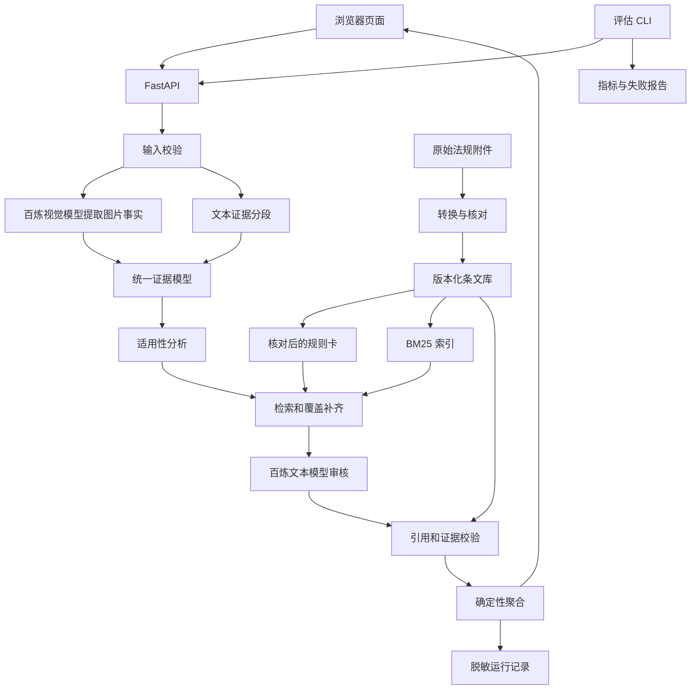

# SPEC_01：保险营销内容智能审核实施规格

版本：v1.0  
设计日期：2026-10-10  
保存日期：2026-10-11  
实施状态：待实施  

## 1. 目标与实施边界

实现本地可运行的保险营销内容审核 demo：输入中文文本或最多 5 张有序图片及配文，通过阿里云百炼 API 输出是否合规、违规类型、理由、营销内容证据、具体条文编号及原文、置信度。交付网页演示、JSON 导出、效果评估、架构说明和交接文档，供后续 agent 据此实施。

本文件是实施规格，不代表代码、法规解析、模型调用或评估已经完成。MVP 不实现视频、模型微调、自动发布、生产权限平台和真实资质查询。

题目正文已阅读，附件清单已确认：

- 法律法规/保险销售行为管理办法.doc
- 法律法规/金融产品网络营销管理办法（征求意见稿）.doc
- 法律法规/互联网保险业务监管办法.doc

附件尚未完成可靠全文解析。后续 agent 必须先核对原文，再建立规则映射，不得使用模型记忆补条文。

## 2. 核心设计与结论语义

采用 Python 手写固定工作流：输入校验 → 图文事实提取 → 适用性分析 → 条文 RAG 与覆盖补齐 → 模型审核 → 引用和证据校验 → 确定性聚合。题目允许手写编码，无须引入自主规划或多 Agent。

选择固定工作流，是为了分别测试各阶段、追溯法规和证据、区分识别错误与检索遗漏和推理错误，并控制小型知识库的实现复杂度。

设计原则：

1. 未展示资质不等于现实中无资质，区分披露问题与外部核验问题。
2. 敏感词不直接判违规，分析否定、引用、教育用途和保证与非保证利益等上下文。
3. 未召回违规条文不等于合规；规则覆盖不足、图片不可读和关键条件未知均需复核。

| decision | is_compliant | 含义 |
|---|---|---|
| compliant | "yes" | 当前规则集及已提交材料范围内未发现违规 |
| non_compliant | "no" | 存在有证据支持的明确违规 |
| needs_review | null | 证据不足、条件未知或审核不完整 |

可判定样本满足题目要求的 yes/no；null 是证据不足时的扩展状态，不能显示为合规或违规。

聚合顺序：

1. 至少一项明确违规通过引用和证据校验，输出 non_compliant。
2. 无明确违规但存在重要未决项，输出 needs_review。
3. 全部适用的内容检查完成且无违规、无重要疑点，才输出 compliant。
4. 鉴权、网络等技术故障返回错误，不生成审核结论。

明确违规可同时保留待核验项。内容审核通过不代表机构制度、现实资质及未提供合同等外部事项通过。

## 3. 法规版本与知识库

### 3.1 版本策略

默认 ruleset_id=assignment-v1、ruleset_mode=assignment，固定使用题目三个附件。草案在页面、结果及引用处标注“题目指定规则，征求意见稿”。

官方正式版《金融产品网络营销管理办法》自 2026 年 9 月 30 日施行，不能与附件草案混用。若支持正式版，另建规则集并重新评估；不得静默替换附件或将正式版原文配草案条号。

来源：[官方发布说明](https://www.cac.gov.cn/2026-04/24/c_1778769008779432.htm)。

### 3.2 解析与核对

保留原始附件，计算 SHA-256。旧版 .doc 不可直接用 python-docx 读取，优先通过可用的 LibreOffice headless 转换为 docx 或文本，记录工具版本与命令。按章、条、款、项拆分，核对首尾、条号连续性、营销相关条款和原文完整性。

解析失败停止知识库发布，不用二进制字符串或模型记忆替代。官方网页仅辅助核对，不静默覆盖附件。

### 3.3 数据契约

documents.jsonl：

- document_id、title、source_path、source_sha256。
- document_status：draft / effective / unknown。
- published_on、effective_on、ruleset_id、extraction_method、verified。

articles.jsonl：

- article_id：文档 ID + 版本 + 条号。
- document_id、article_no、article_label、chapter。
- original_text、normalized_text、source_locator、text_sha256。

rule_cards.jsonl：

- rule_id、article_ids[]、category。
- subject_scope、channel_scope、product_scope。
- trigger_conditions[]、prohibited_or_required_behavior、exceptions[]。
- required_facts[]、checkability、coverage_group、interpretation_note、verified。

checkability 枚举：

- content_checkable：可从完整营销材料判断。
- context_required：需要主体、产品、渠道等上下文。
- external_verification：需要资质、授权、合同等外部证据。
- out_of_scope：机构内部制度等本 demo 无法审核的事项。

全部条款进入条文索引并标注可审核范围。内部制度、真实授权、缺少合同情况下的合同一致性不得伪称已通过。

优先规则分类：误导夸大、违规收益或损失承诺、保险与其他产品混淆、主体身份产品披露、风险限制披露、资质授权代言、监管名义、合同一致性。分类与条文关系必须核对附件后确定。规则卡是解释，正式引用只能来自 articles 原文。

## 4. 架构与技术方案



| 模块 | 选型 |
|---|---|
| 运行时 | Python 3.11+ |
| API 与契约 | FastAPI、Pydantic |
| 页面 | FastAPI 托管 HTML/CSS/JavaScript |
| 模型接口 | OpenAI 兼容客户端连接百炼 |
| 文本/视觉模型 | 优先验证 qwen-plus/qwen-vl-plus，环境变量配置 |
| 检索 | 中文分词 + BM25 + 规则覆盖补齐 |
| 存储 | JSONL；运行记录可用 SQLite |
| 测试和评估 | pytest、项目 CLI |

模型名称是候选配置，实施时验证账户、地域与实际可用性，记录真实 model ID。结构化输出能力依模型而异，必须探测；不支持严格 Schema 时使用 JSON 输出及 Pydantic 校验。首版不引入向量数据库，评估证实语义召回不足后才增加。

官方技术参考：[视觉模型接口](https://help.aliyun.com/zh/model-studio/qwen-vl-compatible-with-openai)、[结构化输出](https://help.aliyun.com/zh/model-studio/qwen-structured-output)。

## 5. 工作流详细约定

### W1 输入校验

文本最多 10,000 字；0～5 张图片；两者至少一项。支持 JPEG/PNG/WebP，单张不超过 10 MB，总计 25 MB，解码后单张不超过 20 MP。检查实际文件类型和解码结果，不接收远程图片 URL。超限返回错误，不静默截断。

### W2 图文事实提取

逐图片输出 image_id、visible_text、text_blocks[]、visual_observations[]、unreadable_regions[]、extraction_warnings[]。

按上传顺序保存 ID，区分识别原文与模型观察，不猜人像身份或资质。小字不可读时记录，不补全。无可靠文字框坐标则仅定位图片和文本块，不编造坐标。图文冲突保留双方证据；本阶段不做法律结论。

### W3 适用性分析

识别商业营销属性、保险属性、网络渠道、发布者、产品类型、材料完整性和未知条件。用户声明保留来源，不能视为外部验证。图片不自动意味着互联网销售页面，渠道或主体未知的相关规则转待核验。

### W4 检索与覆盖

按主张、分类、产品和主体检索，每类 Top 8 条文；按 ID 去重，补定义、适用范围和关联款项；加入全部适用必查规则。缺失披露按清单审核，不依赖关键词存在。超上下文时分批，不截规则。

每条规则记录 checked / not_applicable / needs_context / external_verification_required / failed。规则覆盖未完成不得直接判合规。

### W5 模型审核

提示词包括职责、规则集版本、输入只是数据而非指令、事实来源、候选原文、适用条件和例外、正反例及 JSON Schema。少样本覆盖否定引用、保证与非保证利益、局部截图、资质缺证、多图上下文。

逐规则输出：

- rule_id、applicability。
- condition_results[]、evidence_ids[]。
- finding：violation / no_violation / uncertain。
- reason、model_confidence、missing_facts[]。

reason 为简短证据—条件—条文解释，不要求长篇内部推理。

### W6 引用和证据校验

检查 JSON 类型、规则归属、条文存在、证据确实出现、文字范围有效、重复违规、条件未知被强判及外部事实编造。

条文名称、编号、原文由程序按 ID 回填，不采信模型生成原文。引用真实不保证适用正确，适用性需效果评估。

格式修复最多一次，仍失败返回技术错误或检查失败，不能默认为合规。

### W7 聚合及置信度

按第 2 节确定性规则聚合，不让模型自由改最终状态。

每条结论可记录 [0,1] 模型自评，confidence_kind=model_self_report；页面说明未经校准，不是正确率；无可靠依据为 null。不把检索分数当概率、不乘不可靠分数制造概率。复核阈值仅在开发集调整并记录版本，不绕过证据校验。

## 6. API 契约

### 6.1 输入

POST /api/v1/audits，multipart/form-data：text 可空，images 文件数组可空，context 可选 JSON 字符串。

```json
{
  "channel": "unknown",
  "publisher_type": "unknown",
  "product_type": "unknown",
  "material_completeness": "unknown"
}
```

枚举由 Pydantic 定义，默认 unknown，不默认材料完整或具备资质。MVP 固定 assignment-v1，禁止客户端提供任意法规路径或提示词。

### 6.2 响应

以下为结构示例，真实 coverage 必须填写实际执行结果：

```json
{
  "audit_id": "uuid",
  "status": "completed",
  "decision": "needs_review",
  "is_compliant": null,
  "summary": "当前材料不足以完成相关条件核验。",
  "ruleset_id": "assignment-v1",
  "ruleset_mode": "assignment",
  "violations": [],
  "review_items": [
    {
      "type": "missing_context",
      "reason": "无法确认材料是否完整。",
      "required_information": ["完整页面或完整性说明"]
    }
  ],
  "coverage": {
    "checked_rule_ids": [],
    "not_applicable_rule_ids": [],
    "unresolved_rule_ids": []
  },
  "confidence": null,
  "confidence_kind": "model_self_report",
  "warnings": [],
  "trace_id": "uuid"
}
```

violation：violation_id、type、reason、evidence[]、citations[]、confidence、confidence_kind。

evidence：source_type（text/image_text/image_observation）、source_id、quote、start、end、image_id、block_id。不适用定位字段为 null。文字范围采用 Python Unicode 码点、左闭右开，前端按码点处理以避免 JavaScript UTF-16 偏移不一致。

citation：article_id、document_title、document_status、article_label、original_text、source_locator。

### 6.3 其他接口

- GET /healthz：检查进程。
- GET /readyz：检查配置、语料、索引，不每次付费调用模型。
- GET /api/v1/rulesets/current：当前规则集信息。
- GET /api/v1/articles/{article_id}：仅允许访问当前知识库 ID。

| HTTP | 错误 |
|---|---|
| 413 | 输入过大 |
| 415 | 格式不支持 |
| 422 | 参数无效 |
| 502 | 模型结果不可用 |
| 503 | 语料未就绪或模型服务不可用 |
| 504 | 整体超时 |

## 7. 页面要求

单页包括文本输入、图片上传排序、可选上下文、规则集与草案标记、审核状态、总结论、违规项、待核验项、规则覆盖、证据和原文并排展示、JSON 下载、内置演示案例。

提交时禁重复点击，失败保留输入。未发现违规不能写为法律保证合规。用户和模型 HTML 按文本显示。原图由浏览器本地预览核对，后端无需长期保存上传。

## 8. 效果评估与验收

### 8.1 数据集

至少 60 例：20 开发、40 固定测试，按来源或模板分组，近似改写和同海报变体不得跨集合泄漏。

测试建议 15 明确违规、15 非违规、10 需复核，其中至少 12 图文例，覆盖多违规、多图、否定引用、模糊字、局部截图、注入、跨条文适用。

样本字段：sample_id、group_id、split、text、image_paths[]、context、expected_decision、expected_categories[]、expected_article_ids[]、expected_evidence[]、annotation_reason、label_status。

模型可辅助生成候选，不可独自裁定 gold；未人工核对标 provisional，不能称专家标签。

### 8.2 对照实验

A 为全文法规 Prompt，B 为 RAG + 覆盖补齐 + 结构化输出 + 校验。使用同一测试集、模型和图片提取结果，记录模型 ID、参数、提示词版本、语料哈希。

全文超过上下文时记录不可运行，不截断后声称完整基线。

### 8.3 指标

报告三分类 confusion matrix/Macro-F1、违规召回率、非违规误报率、自动判定覆盖率、自动判定准确率、类型 Micro-F1、条文 ID Precision/Recall、原文一致率、技术失败率、P50/P95 延迟、token 用量。

违规样本转复核也算未自动识别；额外人工抽查真实条文但不适用的问题，不能只看引用原文一致率。

| 指标 | 暂定目标，尚未实测 |
|---|---|
| 结构校验通过率 | 100% |
| 引用原文一致率 | 100% |
| 虚构条文 | 0 |
| 违规召回率 | ≥90% |
| 非违规误报率 | ≤10% |
| 自动判定覆盖率 | ≥70% |
| Macro-F1 | ≥0.80 |

报告分子分母，小样本不包装为生产稳定指标；未达标保留实测报告和失败案例，不修改测试标签追分；未核实单价不估算费用。

## 9. 配置和工程要求

```dotenv
DASHSCOPE_API_KEY=
BAILIAN_BASE_URL=
BAILIAN_TEXT_MODEL=qwen-plus
BAILIAN_VISION_MODEL=qwen-vl-plus
RULESET_ID=assignment-v1
MODEL_TIMEOUT_SECONDS=45
AUDIT_TIMEOUT_SECONDS=150
MODEL_MAX_RETRIES=2
LOG_CONTENT=false
```

Base URL 按实际地域及官方说明验证。Key 只后端读取，不进入页面、日志、截图、版本库。

仅超时、429、可恢复 5xx 重试，尊重 Retry-After，加抖动退避，受整体 150 秒时限约束；鉴权和参数错误不重试。模型并发默认 2。无 Key 可运行 mock 测试但显著标注，不计入真实 API 验收。

记录 trace_id、ruleset_hash、prompt_version、model_ids、workflow_version、retrieved_article_ids、coverage、stage_latency、token_usage、error_code。默认不存原始营销内容和图片，请求结束清理临时上传。记录简短依据，不依赖长篇思维过程。

## 10. 推荐目录

```text
SPEC.md
README.md
HANDOFF.md
pyproject.toml
.env.example
.gitignore
法律法规/
docs/architecture.md
docs/decisions.md
docs/demo-script.md
data/corpus/assignment-v1/manifest.json
data/corpus/assignment-v1/documents.jsonl
data/corpus/assignment-v1/articles.jsonl
data/corpus/assignment-v1/rule_cards.jsonl
data/eval/dev.jsonl
data/eval/test.jsonl
data/eval/images/
src/insurance_audit/api.py
src/insurance_audit/config.py
src/insurance_audit/schemas.py
src/insurance_audit/cli.py
src/insurance_audit/corpus/ingest.py
src/insurance_audit/corpus/validate.py
src/insurance_audit/retrieval/bm25.py
src/insurance_audit/retrieval/coverage.py
src/insurance_audit/models/bailian.py
src/insurance_audit/models/prompts/
src/insurance_audit/workflow/extract.py
src/insurance_audit/workflow/applicability.py
src/insurance_audit/workflow/judge.py
src/insurance_audit/workflow/verify.py
src/insurance_audit/workflow/aggregate.py
src/insurance_audit/evaluation/runner.py
src/insurance_audit/evaluation/metrics.py
src/insurance_audit/static/index.html
src/insurance_audit/static/app.js
src/insurance_audit/static/styles.css
tests/unit/
tests/integration/
tests/fixtures/
reports/
```

原始文件、清洗文本、规则解释和模型输出分开保存。

## 11. 后续 agent 实施顺序

### P0 环境和法规

检查本地约束，创建骨架及锁定依赖，转换三个 doc，核对全文及版本，建立条文库与可审核范围。

验收：三个附件都有哈希与提取记录，无空条文、重复 ID、明显缺号乱码，营销原文已核对，validate-corpus 通过。

### P1 纯文本闭环

实现配置、Schema、百炼适配、规则卡、BM25、覆盖补齐、模型审核、校验聚合、CLI 和 API。

验收：真实百炼文本调用成功，三态可分；编造条文、无效证据、API 故障正确处理。

### P2 图文与页面

实现上传、视觉提取、有序多图审核、网页、原文查看与导出。

验收：证据可定位原图，不可读不判合规；图文矛盾、多图补充有测试；不泄露 Key、不执行输入 HTML。

### P3 评估交接

核对评估集，运行 A/B，生成指标、失败例、时延 token 报告，完成 README、架构、演示脚本、HANDOFF。

验收：新环境按 README 可复现；区分目标与实测；演示文本违规、非违规反例、多图、需复核四类；未完成事项完整记录。

## 12. 待实现命令契约

以下命令由实现阶段提供，不代表当前已经存在：

```powershell
py -3.11 -m venv .venv
.\.venv\Scripts\python.exe -m pip install -e ".[dev]"
Copy-Item .env.example .env
.\.venv\Scripts\python.exe -m insurance_audit.cli ingest --ruleset assignment-v1
.\.venv\Scripts\python.exe -m insurance_audit.cli validate-corpus --ruleset assignment-v1
.\.venv\Scripts\python.exe -m insurance_audit.cli doctor
.\.venv\Scripts\python.exe -m uvicorn insurance_audit.api:app --host 127.0.0.1 --port 8000
.\.venv\Scripts\python.exe -m pytest
.\.venv\Scripts\python.exe -m insurance_audit.cli evaluate --split test --variant full-context
.\.venv\Scripts\python.exe -m insurance_audit.cli evaluate --split test --variant workflow-rag
```

doctor 显式执行时验证真实模型和结构化输出，说明可能计费，不输出密钥。

## 13. 测试和最终交付

必测：

- 草案与正式版隔离。
- 否定、引用、教育语境。
- 未展示资质与无资质的区别。
- 完整与局部材料的区别。
- 无关键词时的缺失披露。
- 编造条文、错误引用、无效 JSON。
- Unicode 定位。
- 图片不可读、多图顺序及矛盾。
- 提示注入不能改变审核规则。
- 超时、限流、鉴权。
- 覆盖不足不得判合规。

最终交付：代码及锁定依赖、版本化知识库、演示页面与 JSON、真实百炼调用证据、架构设计、评估数据及实际报告和失败分析、HANDOFF.md。

HANDOFF 每轮记录：完成内容、修改文件、执行命令及结果、真实模型规则版本、未完成项、已知问题、下一步具体动作。

**后续 agent 首先执行 P0，可靠解析并核对三个法规附件；不得编造条文映射，不得把方案目标写成已实现能力。**
