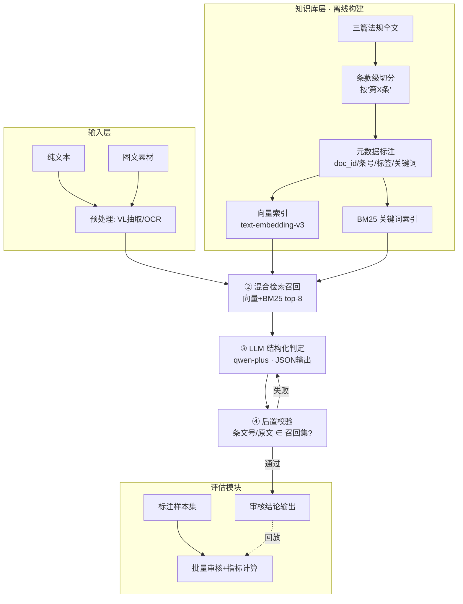

# SPEC_02：基于大模型的保险营销内容智能审核系统

> 版本：v1.0　日期：2026-10-10
> 本 spec 面向后续执行 agent：按「§9 执行指令」即可独立继续开发，无需再向提问者澄清。
> 原始考题：《实操考题_候选人.docx》——基于大模型的保险营销内容智能审核。

---

## 1. 任务理解

### 1.1 考题要求（必须全部满足，验收见 §10）

**功能性**
- 输入：一段文本，或一组图文（图片+文案）。
- 输出：① 是否合规（yes/no）；② 违规类型（如"夸大收益""无资质代言"）；③ 引用的具体规则条文编号与原文。

**技术性**
- 使用**百炼大模型 API**（DashScope），可用主流 Agent 框架或手写编码。
- 至少使用以下一种增强路径：Prompt Engineering / RAG / Agent / Workflow（本方案使用 RAG + Workflow + Prompt Engineering 三者组合）。
- 实现基本的效果评估模块。
- 交付演示代码、架构图、关键设计说明。

### 1.2 审核依据（三篇监管文档）

1. 《保险销售行为管理办法》（国家金融监督管理总局令 2023 年第 2 号，2023-09-20 公布，2024-03-01 施行）
2. 《金融产品网络营销管理办法》（中国人民银行等八部门公告〔2026〕第 9 号，2026-04-21 公布，2026-09-30 施行）
3. 《互联网保险业务监管办法》（银保监会令 2020 年第 13 号，2020-12-07 公布，2021-02-01 施行，同时废止 2015 年暂行办法）
所有监管文档都已经落入 /法律法规 dir 中

> ⚠️ 考题附件未随卷提供。执行 agent 的第一步是从官方/权威公开渠道获取三篇文档全文（见 §9.1）。三篇均为公开发布的监管文件，可合法获取。

### 1.3 关键挑战与对策

| 挑战 | 对策 |
|---|---|
| 条文编号/原文引用易幻觉 | RAG 把召回条文作为唯一依据来源 + 后置白名单校验（§5.4） |
| 条款隐含逻辑（如"风险提示缺失"需判断"应当有而没有"） | 判定 Prompt 中内置违规类型分类法与判定准则（§4.2、§5.3） |
| 图文输入 | qwen-vl 多模态抽取文字，或 PaddleOCR 兜底（§5.1） |
| 单句无上下文 | 条款级切分 + 按违规类型标签二次过滤召回（§3.2、§5.2） |
| 置信度不可比 | 规则化合成置信度，不接受模型自由打分（§5.5） |

---

## 2. 总体架构

### 2.1 架构图（Mermaid，交付文档中直接渲染）



### 2.2 技术路径声明（对照考题"四选一以上"）

- **RAG**：条款级切分 + 双路混合检索，条文引用全部来自召回集。
- **Workflow**：预处理 → 检索 → 判定 → 校验 四步确定性流水线（Python 手写编排，环依赖清晰、易评估）。
- **Prompt Engineering**：结构化 JSON 输出 + 违规类型分类法注入 + few-shot 示例。

### 2.3 技术选型

| 组件 | 选型 | 说明 |
|---|---|---|
| 判定 LLM | 百炼 `qwen-plus`（备选 `qwen-max`） | DashScope，OpenAI 兼容模式调用 |
| 多模态抽取 | 百炼 `qwen-vl-max` | 图文→文字与版式描述 |
| Embedding | 百炼 `text-embedding-v3`（1024 维） | 与判定模型同平台，免额外密钥 |
| 向量库 | FAISS（本地内存索引） | demo 量级（数百条款）无需独立向量库服务 |
| BM25 | `rank_bm25` | 条文编号等精确词匹配兜底 |
| 编排 | 手写 Python Workflow | 不用重框架；如需框架可用 LangChain，但不强制 |
| OCR 兜底 | `paddleocr`（可选） | 仅在 VL 抽取不可用时启用 |
| 评估 | 纯 Python 脚本 + sklearn 指标 | 见 §7 |
| Demo 界面 | Streamlit 单页（可选加分项） | 文本框/图片上传 → 结论卡片 |

**环境变量**：`DASHSCOPE_API_KEY`（唯一必需密钥）。

---

## 3. 数据层设计

### 3.1 法规条款切分

- 以正则 `第[一二三四五六七八九十百零]+条` 为锚点切分，每条为一个 chunk；保留章/节标题作为 chunk 的 `chapter` 元数据。
- 条款过长（>800 字）时按款（"（一）（二）…"）二级切分，子块继承父条号，记 `article_no` + `sub_item`。
- 产物：`data/regulations/chunks.jsonl`，每行一个条款。

```json
{
  "chunk_id": "insurance_sales_mart::art_23",
  "doc_id": "insurance_sales_mgmt",
  "doc_title": "保险销售行为管理办法",
  "chapter": "第三章 保险销售行为管理",
  "article_no": "第二十三条",
  "text": "保险公司、保险中介机构……（条款原文）",
  "tags": ["禁止用语", "夸大收益"],
  "keywords": ["预期收益", "保证收益", "分红"]
}
```

- `tags` 由"关键词规则初标 + 人工确认"生成，用于 §5.2 的标签过滤召回。

### 3.2 违规类型分类法（判定 Prompt 的受控词表）

从三篇文档归纳，输出**必须**落在该词表内（可多选）：

| 代码 | 违规类型 | 典型依据 |
|---|---|---|
| `EXAGGERATE_RETURN` | 夸大收益/承诺收益 | 销售办法·禁止炒停与夸大收益类条款 |
| `GUARANTEE_PRINCIPAL` | 承诺保本/刚性兑付 | 网络营销办法·禁止性宣传 |
| `MISSING_RISK_DISCLOSURE` | 风险提示缺失或不充分 | 三篇均有，销售办法/网保办法重点 |
| `MISLEADING_COMPARISON` | 误导性对比/片面比较 | 销售办法·销售宣传规范 |
| `UNQUALIFIED_PROMOTION` | 无资质宣传/代言/非持牌机构营销 | 网络营销办法·资质要求 |
| `FABRICATE_ENDORSEMENT` | 假借监管/国家机关名义背书 | 网络营销办法·禁止性规定 |
| `HIDE_TERMS` | 隐瞒条款/免责事项未提示 | 销售办法、网保办法 |
| `IMPROPER_CHANNEL` | 违规渠道/页面嵌套销售 | 网保办法·自营平台要求 |
| `TARGET_MISMATCH` | 向不适当对象销售/诱导 | 销售办法·适当性管理 |
| `OTHER_VIOLATION` | 其他违规（须附理由） | 兜底 |

> 执行 agent 在拿到三篇全文后，必须逐条核对本表与真实条文的映射，可增补类型但**禁止删减**，并更新本 spec 的映射列。

### 3.3 标注评估集

- 规模：**60 条起步**（合规 30 / 违规 30，违规覆盖每类 ≥2 条）。
- 来源：由 qwen-max 按分类法生成候选 → 人工/agent 逐条校对修正（考题允许，需在 README 注明）。
- 文件：`data/eval/samples.jsonl`

```json
{
  "id": "eval_001",
  "input": {"text": "这款年金险保本保息，年化收益5%写进合同，银行都推荐！"},
  "images": [],
  "label": {
    "compliant": "no",
    "violation_types": ["GUARANTEE_PRINCIPAL", "EXAGGERATE_RETURN"],
    "gold_articles": ["insurance_sales_mgmt::第二十三条"]
  }
}
```

`gold_articles` 允许为空（标注者不确定时），此时该样本不参与"条款命中率"指标，只参与判定指标。

---

## 4. 接口与数据结构

### 4.1 审核请求/响应（系统对外唯一接口）

```json
// ReviewRequest
{
  "text": "string，可空（纯图文时为空）",
  "images": ["本地路径或可访问URL，可空"]
}

// ReviewResponse
{
  "compliant": "yes | no",
  "violations": [
    {
      "type": "EXAGGERATE_RETURN",
      "type_label": "夸大收益/承诺收益",
      "reason": "文案宣称'收益是银行三倍'，属于夸大保险产品收益",
      "evidence_span": "收益是银行三倍",
      "articles": [
        {
          "doc_title": "保险销售行为管理办法",
          "article_no": "第二十三条",
          "quote": "（召回集中该条的原文摘录，逐字）"
        }
      ]
    }
  ],
  "confidence": 0.0,
  "normalized_text": "（图文输入时抽取出的全文，便于审计）",
  "meta": {"retrieved_chunk_ids": ["..."], "model": "qwen-plus", "latency_ms": 0}
}
```

### 4.2 LLM 判定输出 Schema（强约束）

模型只允许输出如下 JSON（用 `response_format={"type":"json_object"}`）：

```json
{
  "compliant": "yes|no",
  "violations": [
    {
      "type": "分类法代码",
      "reason": "≤100字",
      "evidence_span": "被审文案中的原句摘录",
      "article_refs": [{"chunk_id": "召回集chunk_id", "article_no": "第X条"}],
      "self_confidence": 0.0
    }
  ]
}
```

**硬约束（写进 system prompt + 后置校验强制执行）**：
1. `article_refs[].chunk_id` 必须 ∈ 本次召回集，否则该校验失败。
2. `type` 必须 ∈ §3.2 词表，否则映射为 `OTHER_VIOLATION` 并在 reason 中保留原值。
3. 无违规时 `violations` 为空数组、`compliant="yes"`。

---

## 5. 审核引擎详细设计（Workflow 四步）

### 5.1 Step 1：输入归一化 `normalize_input()`

- 纯文本：原样返回。
- 含图片：调 `qwen-vl-max`，prompt 要求"逐字转录图中全部文字，并简述画面主体与人物身份线索（用于识别代言/资质场景）"。输出 `normalized_text = 用户文案 + "\n[图片文字]\n" + OCR文本 + "\n[画面描述]\n" + 描述`。
- 多张图片：逐张抽取后拼接，以 `[图片1]…[图片2]…` 分隔。
- 失败降级：VL 调用失败 → PaddleOCR 兜底；再失败 → 仅审文本并在 `meta.warnings` 记录。

### 5.2 Step 2：混合检索召回 `retrieve()`

- 查询构造：`query = normalized_text`（≤512 字截断）；另生成"违规类型候选词"附加查询（用分类法标签名 + 文案关键词拼接，提升 BM25 命中）。
- 双路召回：向量 top-8（text-embedding-v3 + FAISS 余弦）∪ BM25 top-8 → 去重 → RRF 融合（k=60）→ 取 **top-8**。
- 标签加权：若 Step1 文本命中某 `tag` 的关键词表，该 tag 条款 RRF 分 ×1.2。
- 输出：`retrieved_chunks: list[Chunk]`，附带 `chunk_id` 白名单。

### 5.3 Step 3：LLM 结构化判定 `judge()`

System prompt 骨架（执行 agent 以此为底本，可微调措辞，不得改变约束项）：

```
你是金融营销内容合规审核员。审核依据仅限下方【监管条文】，不得引用未提供的条文。

【监管条文】
[chunk_id] 《文档名》第X条：原文…
（共8条）

【违规类型词表】（多选，必须从下列代码选择）
EXAGGERATE_RETURN 夸大收益/承诺收益；GUARANTEE_PRINCIPAL 承诺保本；
MISSING_RISK_DISCLOSURE 风险提示缺失；MISLEADING_COMPARISON 误导性对比；
UNQUALIFIED_PROMOTION 无资质宣传/代言；FABRICATE_ENDORSEMENT 假借监管名义；
HIDE_TERMS 隐瞒条款/免责未提示；IMPROPER_CHANNEL 违规渠道；
TARGET_MISMATCH 不适当销售；OTHER_VIOLATION 其他。

【判定准则】
1. 逐条对照监管条文，有明确依据才判违规；存疑则合规。
2. 引用条文必须给出 chunk_id 与条号，禁止编造。
3. "风险提示缺失"类：只有当文案属于应当提示风险而未提示时判定。
4. 输出严格 JSON（schema 见下），不得输出任何其他文字。

【输出Schema】…（§4.2）
```

- few-shot：注入 2 正例 + 2 违例（从评估集留出，不重复计入评估）。
- 参数：`temperature=0`，`max_tokens=1500`。
- 若 JSON 解析失败：重试 1 次（prompt 追加"上次输出非合法 JSON，请只输出 JSON"）。

### 5.4 Step 4：后置校验 `validate()`（防幻觉关键）

1. 每个 `article_refs[].chunk_id` ∈ 召回白名单；不在则剔除该条引用。若某 violation 剔除后无引用 → 该 violation 降级为 `OTHER_VIOLATION` 且 reason 标注"依据待人工复核"，且 `compliant` 维持模型判定。
2. `quote` 字段由系统按 chunk_id 从本地条款库**回填原文**，绝不使用模型生成的原文。
3. 校验失败（剔除过引用）→ 重判 1 次（prompt 追加白名单强调）；仍失败则按降级规则出结果并在 `meta.validation="degraded"` 标记。

### 5.5 置信度合成（规则化）

```
confidence = 0.5 * avg(violation.self_confidence)
           + 0.3 * (有效引用数 / max(1, 声明引用数))
           + 0.2 * (1 若校验一次通过 else 0.5)
合规样本：confidence = self_confidence(由模型在 compliant=yes 时给出) * 校验系数
```
范围裁剪到 [0,1]，保留两位小数。

### 5.6 多违规排序

按固定严重度排序输出：`FABRICATE_ENDORSEMENT > UNQUALIFIED_PROMOTION > GUARANTEE_PRINCIPAL > EXAGGERATE_RETURN > MISLEADING_COMPARISON > HIDE_TERMS > MISSING_RISK_DISCLOSURE > TARGET_MISMATCH > IMPROPER_CHANNEL > OTHER_VIOLATION`。

---

## 6. 项目结构与代码骨架

```
insurance-review/
├── README.md                  # 考题对照、运行说明、架构图
├── requirements.txt           # dashscope, faiss-cpu, rank_bm25, pydantic, streamlit(可选), jieba
├── .env.example               # DASHSCOPE_API_KEY=
├── config.py                  # 模型名/top-k/阈值 全部集中于此
├── data/
│   ├── regulations/           # 三篇法规原文 txt（§9.1 获取）
│   │   ├── 保险销售行为管理办法.txt
│   │   ├── 金融产品网络营销管理办法.txt
│   │   └── 互联网保险业务监管办法.txt
│   ├── chunks.jsonl           # 切分产物
│   └── eval/samples.jsonl     # 标注评估集
├── src/
│   ├── ingest/
│   │   ├── parse_regulations.py   # 条款切分+元数据 → chunks.jsonl
│   │   └── build_index.py         # 构建 FAISS+BM25 索引 → data/index/
│   ├── pipeline/
│   │   ├── normalize.py       # Step1 图文归一化(qwen-vl)
│   │   ├── retrieve.py        # Step2 混合检索
│   │   ├── judge.py           # Step3 LLM判定(prompt模板在 prompts/)
│   │   ├── validate.py        # Step4 后置校验+原文回填
│   │   └── review.py          # review(ReviewRequest)->ReviewResponse 主入口
│   ├── prompts/judge_prompt.py    # system/user 模板与 few-shot 样例
│   └── schemas.py             # pydantic 模型（§4 全部结构）
├── eval/
│   ├── run_eval.py            # 批量审核 + 指标计算 → eval_report.md
│   └── eval_report.md         # 生成物
├── demo/app.py                # Streamlit 演示页（可选加分项）
└── tests/test_smoke.py        # 3 条用例冒烟（合规定、违规、图文）
```

**主入口约定**（后续 agent 不得改签名）：

```python
# src/pipeline/review.py
def review(req: ReviewRequest) -> ReviewResponse: ...
```

---

## 7. 评估模块设计

### 7.1 指标（eval/run_eval.py 输出 eval_report.md）

| 指标 | 定义 | 目标（demo 级） |
|---|---|---|
| 合规判定 Accuracy | compliant 与 label 一致率 | ≥ 80% |
| 违规判定 Precision/Recall/F1 | 以"判违规"为正类 | F1 ≥ 0.80 |
| 违规类型 macro-F1 | §3.2 词表多标签 macro-F1 | ≥ 0.70 |
| 条款命中率 Article-Hit | 引用条号 ∩ gold_articles 非空的违规样本占比（仅统计有 gold 的样本） | ≥ 70% |
| 引用幻觉率 | 校验阶段被剔除的引用数 / 模型声明引用总数 | ≤ 5% |

### 7.2 运行方式

```bash
python eval/run_eval.py --samples data/eval/samples.jsonl --out eval/eval_report.md
```

- 逐样本调 `review()`，记录原始响应；指标用 sklearn 计算。
- 报告需包含：总表 + 每类违规的混淆统计 + ≥5 条错误案例分析（错判原因归类：检索未召回 / 模型误判 / 校验降级）。

### 7.3 防过拟合约定

few-shot 样例与评估集**零重叠**；调 prompt 时若需验证，另建 `dev` 集 10 条，评估集只在最终跑一次。

---

## 8. 非功能与风险

| 风险 | 应对 |
|---|---|
| 百炼 API 限流/超时 | 统一封装带指数退避重试（3 次），评估批量跑加 `sleep` 节流 |
| 法规文本版本差异 | chunks.jsonl 记录获取来源 URL 与获取日期；README 注明版本 |
| 图文素材无法访问 URL | 仅支持本地路径与 http(s)；VL 失败有 OCR 兜底（§5.1） |
| 模型输出不稳定 | temperature=0 + JSON mode + 校验重试，三层兜底 |
| 成本 | 判定用 qwen-plus；仅评估/生成样本时用 qwen-max |

---

## 9. 执行指令（给后续 agent 的 Handoff）

### 9.1 里程碑（按序执行，每步完成即验证）

- **M1 数据就绪**
  1. 获取三篇法规全文（官方发布渠道，如金融监管总局/人民银行官网公开文本），存为 `data/regulations/*.txt`，在文件头注释来源与获取日期。
  2. 跑通 `parse_regulations.py`：条款数合理性自检（三篇合计 100~250 条之间为正常区间），抽样 10 条人工目检切分正确。
  3. 核对并更新 §3.2 分类法与真实条文的映射。
  4. 跑通 `build_index.py`。
- **M2 审核主链路**
  5. 实现 `normalize/retrieve/judge/validate/review` 五模块，满足 §4、§5 全部约束。
  6. 冒烟测试 `tests/test_smoke.py` 全绿（含 1 条图文用例）。
- **M3 评估**
  7. 构建 ≥60 条标注集（§3.3）。
  8. 跑 `run_eval.py`，达成 §7.1 目标；未达标时按错误分析优先修"检索未召回"类问题（调 top-k/标签加权），再调 prompt。
- **M4 交付**
  9. `README.md`：考题要求逐项对照表、架构图（§2.1 mermaid 直接嵌入）、运行步骤、评估结果摘要、已知局限。
  10. （加分）Streamlit demo 页。

### 9.2 硬性约定（不得违反）

1. 唯一密钥：`DASHSCOPE_API_KEY`，代码中不得出现明文 key。
2. `review()` 签名与 ReviewResponse 结构不得变更（评估与 demo 均依赖）。
3. 条文 `quote` 一律本地回填，严禁透传模型生成原文（§5.4-2）。
4. 违规类型必须落在 §3.2 词表；增补类型需同步更新本 spec 与 prompt。
5. few-shot 样例与评估集零重叠（§7.3）。

### 9.3 快速验证清单（交付前逐项打勾）

- [ ] `echo 'DASHSCOPE_API_KEY=...' > .env && python tests/test_smoke.py` 通过
- [ ] 对 §3.3 样例输入，输出含 compliant / violations[].type / articles[].article_no+quote / confidence 四要素
- [ ] 故意构造一条不在召回集的引用场景，验证校验降级逻辑触发
- [ ] `eval_report.md` 五项指标齐全且达标
- [ ] README 含架构图与考题逐项对照表

---

## 10. 考题要求对照表（验收用）

| 考题要求 | 本 spec 落点 |
|---|---|
| 输入文本或图文，输出审核结论 | §4.1 ReviewRequest/Response，§5.1 |
| 是否合规 yes/no | `compliant` 字段 |
| 违规类型 | §3.2 受控词表 |
| 引用条文编号与原文 | §5.4 白名单校验 + 原文回填 |
| 百炼大模型 API | §2.3（qwen-plus / qwen-vl-max / text-embedding-v3） |
| 增强路径 ≥1 种 | §2.2（RAG + Workflow + Prompt Engineering） |
| 效果评估模块 | §7 |
| 代码、架构图、设计说明 | §6 结构、§2.1 架构图、本 spec §1–§8 |
