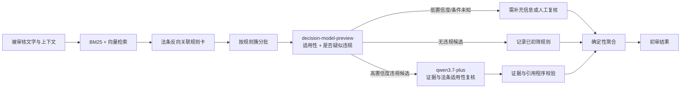

# 初审模式接入 decision-model-preview 实施计划

版本：v1.0  
制定日期：2026-10-18  
状态：待实施  
范围：只调整“初审模式”；完全模式继续使用当前 `qwen3.7-plus + 全部规则 + RAG` 流程。

> **当前阻塞（2026-10-18）**：阿里云目前只通过 Token Plan 个人版提供该模型，而个人版使用规则明确禁止自定义应用后端、自动化脚本和非交互式批量调用。本计划只能作为条件性技术方案；在获得允许后端调用的正式产品或书面授权前，不得把套餐密钥接入 FastAPI 服务。时间与费用估算见 `docs/decision-model-cost-assessment.md`。

## 1. 结论与边界

建议接入，但不把 `decision-model-preview` 直接替换成完整审核引擎。

决策模型适合接管初审模式中“对 RAG 选中的规则逐项判断是否疑似违反”的步骤。它通过 `state + questions + criteria` 返回结构化选项、概率分布和置信度，不生成自然语言理由。因此以下能力继续由现有链路承担：

- 营销文案证据原句定位；
- 法条编号和原文回填；
- 条件、例外、材料完整性和外部核验校验；
- 三态业务结论及规则覆盖台账；
- 低置信度、冲突结果和模型故障的复核或降级。

目标架构是“决策模型初筛 + 现有模型证据复核 + 程序确定性聚合”，而不是由决策模型单独给出最终法律结论。

## 2. 官方能力对当前系统的影响

`decision-model-preview` 使用独立接口：

```text
POST https://token-plan.cn-beijing.maas.aliyuncs.com/compatible-mode/v1/systemone
```

官方接口接受：

- `state`：待判断材料与上下文；
- `questions`：若干类型化问题；
- `criteria`：每个选项的明确判定边界；
- `model=decision-model-preview`。

Choice 问题返回 `choice`、`probabilities`、`confidence`。一次请求可以判断多个问题，适合对同一份材料的多张规则卡并行分类。复杂问题应拆成多个明确问题。

需要特别处理的限制：

1. 模型不生成证据、理由和法条引用，不能直接形成当前 `Violation`。
2. 官方示例的 `confidence >= 0.9` 只是示范，不可直接作为本项目阈值。
3. `confidence` 是模型把握，不是正确率或法律确定性。
4. 当前仅支持 Token Plan 个人版，并使用 `sk-sp-` 前缀的套餐密钥；不能复用现有 DashScope/百炼密钥。
5. 请求格式不是 OpenAI Chat Completions，需建立单独客户端。

## 3. 目标流程



初审仍只检查 RAG 关联到的规则。未被选中的规则继续记为 `not_reviewed`，不能因为决策模型给出高置信度的“未违规”就宣称 46 条规则全部合规。

完全模式不变，仍将 46 条规则全部送入现有审核流程，并用 RAG 补充相关法条。

## 4. 决策问题设计

每张规则卡拆成两个 Choice 问题，符合“复杂判断拆小”的官方建议。

### 4.1 适用性问题

选项固定为：

- `applicable`：全部必要触发条件成立；
- `not_applicable`：至少一个必要条件明确不成立；
- `needs_context`：没有明确不成立的条件，但关键事实缺失；
- `external_verification_required`：需要现实资质、授权、合同或流程记录；
- `out_of_scope`：规则本身不属于内容审核范围。

### 4.2 违规判断问题

选项固定为：

- `violation_candidate`：材料中出现满足该规则的疑似违规行为，且未发现适用例外；
- `no_violation_candidate`：规则适用，但材料没有出现受禁止行为，或已履行内容层面的要求；
- `uncertain`：证据、材料完整性或条件不足，无法可靠二选一。

程序先解释适用性，再解释违规判断，禁止只看 `violation_candidate` 一个字段。比如适用性为 `external_verification_required` 时，不得自动形成违规项。

## 5. 请求装箱

每个请求的 `state` 只放一次公共材料，再放当前批次的规则与法条：

```json
{
  "state": {
    "material": {
      "sources": ["按 source_id 分段的被审核文字"],
      "readable": true,
      "completeness": "complete"
    },
    "declared_context": {
      "channel": "internet",
      "publisher_type": "insurance_institution",
      "product_type": "insurance"
    },
    "rules": [
      {
        "rule_id": "...",
        "trigger_conditions": ["..."],
        "prohibited_or_required_behavior": "...",
        "exceptions": ["..."],
        "checkability": "...",
        "direct_articles": [{"article_id": "...", "text": "法条原文"}]
      }
    ]
  },
  "model": "decision-model-preview",
  "questions": {
    "r01_applicability": {"type": "choice", "instructions": "...", "criteria": {}},
    "r01_finding": {"type": "choice", "instructions": "...", "criteria": {}}
  }
}
```

规则 ID 与 question key 的对应关系由程序保存，不依赖模型回写任意 ID。初始沿用当前每批最多 4 张规则卡的规模，再按真实请求大小、时延和限制调整；不能在未实测前把“多问题并行”理解为无限量装箱。

## 6. 结果映射与降级规则

| 决策结果 | 后续处理 |
|---|---|
| `violation_candidate` 且置信度达到已校准阈值 | 只把该规则送入现有 qwen 证据复核；通过证据、引用及条件校验后才形成违规项 |
| `violation_candidate` 但置信度较低 | 送现有 qwen 复核；仍不可靠则 `needs_review` |
| `uncertain` / `needs_context` | 生成待核验事项，不强判违规或合规 |
| `external_verification_required` | 生成外部核验事项 |
| `not_applicable` | 程序确认必要条件为 false 后记为不适用；否则降为待核验 |
| `no_violation_candidate` | 记为本次初筛未发现该项违规；未查验规则仍保留 `not_reviewed` |
| 401 / 422 | 不重试；记录配置或请求错误，并回退现有初审审核器 |
| 429 / 529 / 暂时网络故障 | 按整体预算退避重试；仍失败则回退现有初审审核器 |

决策模型的概率和置信度只保存在诊断元数据或评估报告中。正式页面在完成校准前不把它显示为“违规概率”。

## 7. 代码改动范围

### D1：独立适配器

- 新增 `src/insurance_audit/models/decision.py`。
- 使用 `httpx.AsyncClient` 调用 `/systemone`，不复用 `Bailian.call()`。
- 建立 Pydantic 请求/响应结构，校验 question key、choice、probabilities 和 confidence。
- 复用现有 `Budget` 的整体截止时间和尝试计数；只对 429、529 和连接故障退避。
- 运行记录不得包含密钥或完整营销内容。

### D2：配置

在 `.env.example` 和 `Settings` 增加：

```dotenv
TOKEN_PLAN_API_KEY=
TOKEN_PLAN_BASE_URL=https://token-plan.cn-beijing.maas.aliyuncs.com/compatible-mode/v1
DECISION_MODEL=decision-model-preview
INITIAL_REVIEW_JUDGE=qwen
DECISION_SHADOW_MODE=true
DECISION_CONFIDENCE_THRESHOLD=
```

`INITIAL_REVIEW_JUDGE` 支持 `qwen` / `decision`。阈值在校准前保持空值，避免误用官方示例 0.9。就绪检查应分别报告 DashScope 与 Token Plan 的配置状态。

### D3：问题编译器

- 新增 `src/insurance_audit/workflow_decision.py`，把已核对的 rule card 编译为 `state/questions/criteria`。
- `criteria` 来自规则卡的必要条件、禁止或要求行为、例外及 checkability，不允许临时生成新规则。
- 保留否定引用、教育科普、局部材料、外部事实和提示注入的明确边界。
- 直接法条只来自本地 `articles.jsonl`，引用仍由程序按 ID 回填。

### D4：服务编排

- 在 `service.py` 的 `rule_selection_mode == "retrieved"` 分支接入决策模型。
- 严格模式分支保持不变。
- 对违规候选和低置信度结果调用现有 `judge_messages + structured + verify`，但只处理候选规则。
- 保留 `not_reviewed` 台账、`limited_rule_scope` 提示与当前确定性 `aggregate()`。
- 在 `meta` 增加 provider、模型 ID、question 数量、阈值版本、回退原因和影子结果差异；不改变现有 API 必填字段。

## 8. 分阶段实施

### D0：授权与接入探针

1. 先向阿里云确认允许自定义应用后端使用的产品、授权和密钥类型；个人版密钥不得接入本项目后端。
2. 获得允许后端调用的正式接口后，将密钥单独放在本地秘密变量中。
3. 用 1 条规则、2 个问题完成真实调用。
4. 记录真实响应结构、最大请求限制、时延、错误码和计费方式。
5. 若授权、接口、账户资格或数据处理要求不满足，停止切换，现有初审不受影响。

验收：真实请求成功；日志不含密钥和材料全文；401、422、429、529 的处理可验证。

### D1：离线适配与契约测试

实现客户端、Schema、问题编译器和响应映射，全部使用 mock 响应验证。

验收：非法 choice、缺 question、概率不完整、置信度越界、超时和回退都有测试。

### D2：影子模式

同一初审请求同时运行现有 qwen 路径和决策模型路径，但页面仍显示现有 qwen 结果。影子结果只进入脱敏评估报告。

验收：现有初审行为零变化；可以逐规则比较适用性、疑似违规和未决项。

### D3：开发集校准

先运行现有 5 条开发案例，随后把开发集补足到至少 20 条，重点增加：

- 明显夸大收益、监管背书、误导对比；
- 否定引用和中性保险科普；
- 伪装科普与提示注入；
- 局部材料、文字不可读和关键条件未知；
- 缺失披露；
- 现实资质、授权、合同一致性等外部核验；
- 一份材料同时触发多条规则。

在开发集上选择置信度分流阈值和批量大小，不修改固定测试集标签追分。

### D4：三路 A/B

在同一材料、同一 RAG 结果和同一规则集上比较：

1. 当前初审：qwen 对 RAG 选中的规则直接审核；
2. 决策初审：decision 判定，qwen 只复核违规候选和不确定项；
3. 决策单模型实验：只用 decision 输出筛查结果，仅用于观察能力上限，不作为正式输出。

指标：

- 顶层违规召回率与漏报率；
- 规则级违规召回率、Precision、Macro-F1；
- `needs_review` 比例；
- qwen 证据复核后的证据/引用校验通过率；
- 否定引用与教育反例误报率；
- 技术失败率和自动回退成功率；
- P50/P95 时延、调用次数及实际套餐消耗；
- 平均每条材料调用 qwen 的规则数和 token 数。

### D5：受控切换

只有通过验收门槛后，才把 `INITIAL_REVIEW_JUDGE=decision` 设为推荐配置。保留 qwen 回退开关；完全模式不切换。部署由项目所有者执行。

## 9. 验收门槛

必须同时满足：

1. 完全模式结果和测试无回归。
2. 红线违规开发案例不得漏报。
3. 固定测试集违规召回率不低于当前初审基线。
4. 否定引用和中性科普误报率不高于当前基线。
5. 任何正式违规项都有被审核文字证据和本地法条引用，并通过现有程序校验。
6. 低置信度、条件未知及外部事实不会被自动判成合规或违规。
7. 决策模型不可用时，初审能在整体时间预算内回退到当前 qwen 路径。
8. 只有在实测显示时延、qwen token 或套餐消耗有明显改善时，才宣称性能或成本收益。

## 10. 测试清单

- `tests/unit/test_decision_client.py`：请求、响应、状态码、重试、预算和脱敏。
- `tests/unit/test_decision_questions.py`：规则卡到 questions 的稳定映射、条件与例外覆盖。
- `tests/unit/test_decision_mapping.py`：Choice 组合到规则状态的确定性映射。
- `tests/unit/test_rag.py`：初审规则选择、未召回规则 `not_reviewed`、完全模式不变。
- `tests/integration/test_api.py`：feature flag、回退、meta、响应兼容。
- 新增影子评测脚本和报告；不把 5 条 provisional 开发案例包装成正式准确率。

## 11. 实施顺序建议

先完成 D0 接入探针，再做 D1 和 D2。影子结果证明决策模型对本项目的规则语义有效后，才进入阈值校准和正式切换。这样可以验证它是否真的减少 qwen 调用和结构修复，而不会牺牲现有证据、法条引用及三态语义。

## 12. 参考

- 阿里云帮助中心：《接入决策模型》，2026-10-18 读取：`decision-model-preview` 的接口、typed questions、Choice/Score/Noul、返回字段、Token Plan 个人版限制及错误处理。
