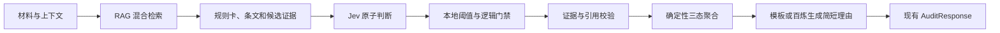

# Jev 判定模型引入分析方案

日期：2026-10-13  
状态：分析与试验方案，尚未接入生产链路

> 本文所称 Jev，指 TypeSafe 的 System One 决策模型。如果这里的“Jev”指其他产品，需要重新核对接口和能力。

## 1. 结论

**现阶段不建议把现有 `qwen3.7-plus` 判定模块整体替换为 Jev。建议先把 Jev 作为“逐规则的封闭式决策器”影子接入，再评估是否采用混合架构。**

Jev 的输入是状态和预先定义的 Choice、Score、Noul（是/否概率）问题，输出是受类型约束的选择或概率。它适合判断“某个条件是否满足”“某条规则是否适用”“该项应归为违规、无违规还是不确定”等封闭问题。它不负责生成完整的法律解释，也不天然给出原文证据片段和多条引用。

当前项目中的文本模型一次需要输出完整 `Finding`：适用性、逐条件结果、证据 ID 与原句、条文 ID、缺失披露、待补事实、简短理由和置信度。因此，直接替换会缺失现有审计契约中的关键字段，并需要重新设计证据选择和理由生成。

更可行的目标是：

1. RAG、规则卡、法条白名单和确定性聚合保持不变。
2. Jev 只判断原子条件、适用性和违规状态。
3. 证据定位、条文回填和最终三态结论仍由本地程序控制。
4. 简短理由由固定模板生成，或交给百炼模型根据已确认的结构化结果生成，但百炼模型不得改变裁决。

这也保留了原考题“使用百炼大模型 API”的要求。若全部换成 Jev，项目可能不再满足该技术约束。

## 2. 当前基线

当前文本链路为：

```text
材料分段
  → BM25 + text-embedding-v4/1024 混合检索
  → 召回条文与全部必查规则补齐
  → qwen3.7-plus 分批输出 JudgeOutput
  → Schema、条件、证据、引用白名单校验
  → 程序确定性聚合 compliant / non_compliant / needs_review
```

当前正式快照为 `official-v3-2026-10-12`，包含 359 条文和 46 张规则卡。判定 Prompt 为 `audit-v1.6-citation-guidance`。

已有工程证据显示：

- 5 条已暴露的合成开发案例可通过当前工程验收。
- `qwen3.7-plus`、batch=2、concurrency=8 的受控重复运行为 10/10 完成，P50 27.83 秒、P95 29.06 秒。
- 历史主要问题包括输出结构失败、条件或证据约束失败、教育材料被误转复核，以及规则批次数和输出长度造成的延迟。
- 目前只有 5 条 provisional 开发种子；20 条开发集和 40 条冻结测试集尚未完成。因此现有资料不能证明 Jev 或当前模型谁的审核准确率更高。

## 3. Jev 可能带来的收益

| 方面 | 可能收益 | 需要验证的前提 |
|---|---|---|
| 输出稳定性 | 输出限制在既定选项或概率，可能消除自由 JSON 生成和字段遗漏 | SDK/API 对本项目问题规模稳定，错误可被本地契约捕获 |
| 判定速度 | 原子问题可在同一状态上并行提问，可能降低 46 条规则分批生成的耗时 | 中文长文本和多规则状态下仍保持稳定时延 |
| 置信度路由 | 可按每个条件的概率与 confidence 将低把握结果转人工复核 | 必须在本项目标注数据上做校准，不能直接采用默认阈值 |
| 可审计性 | 问题、选项、阈值和聚合规则均可显式记录 | 证据和引用仍须由程序单独验证 |
| 成本 | 可能减少长篇生成 token | 需要按真实 API 账单、请求数和重试统计，不能只比较单次调用价格 |

## 4. 不适合直接替换的部分

### 4.1 证据定位

当前接口要求返回营销材料中的原句及 Unicode 位置。Jev 可以判断候选证据是否支持某个条件，但不能代替候选片段发现。仍需由确定性分段、关键词候选或百炼模型生成候选证据，再由 Jev 复核。

### 4.2 法律理由

客户页面需要“证据—条件—条文”的可读解释。Jev 的封闭答案不能直接形成完整理由。建议优先使用固定模板；复杂场景再调用百炼模型润色，而且输入只包含已确认的证据、条件和条文，输出仅作为解释文本。

### 4.3 多条件与条件依赖

同一请求中的 Jev 问题彼此独立，后一个问题不能读取前一个答案。可以同时询问全部候选条件，再由代码根据触发关系、例外和必备条件聚合；不能让模型自行完成隐式的多步法律推理。

### 4.4 外部事实和缺失披露

资质、授权、合同一致性等事项仍需要外部证据。完整材料中缺少必备披露，也必须保留“检查范围”和材料完整性来源。无论概率多高，都不能把未知条件自动变成无违规。

### 4.5 数据与供应商边界

引入 Jev 会增加新的外部模型供应商。正式发送客户营销材料前，需要核对数据保存、训练使用、地域、访问控制、删除机制和合同条款。没有完成这一步时，只允许使用脱敏或合成数据试验。

## 5. 推荐架构



每条规则建议拆为以下问题：

| 问题 | Jev 类型 | 输出用途 |
|---|---|---|
| 材料是否呈现该规则所约束的活动 | Noul 或 Choice | 触发条件 |
| 主体、渠道、产品范围是否适用 | Choice | `applicable / not_applicable / needs_context` |
| 每个必备条件是否满足 | Noul | `condition_results[].met` |
| 是否存在明确违规 | Choice | `violation / no_violation / uncertain` |
| 候选证据是否直接支持该条件 | 每个候选一项 Noul | 证据门禁 |
| 候选条文是否直接支持该违规 | 每个允许条文一项 Noul | 引用适用性复核 |

本地程序继续执行以下硬规则：

- Jev 不能新增规则或条文 ID。
- 证据必须逐字存在于已提交材料，并通过位置校验。
- 引用只能来自该规则的 `allowed_citations`，原文由知识库回填。
- 低置信、条件冲突或证据不足一律转 `needs_review`。
- 至少一项有效违规仍优先聚合为 `non_compliant`；技术错误不能生成业务结论。
- Jev 给出的概率是路由信号，须经开发集校准，不直接显示为“正确率”。

## 6. 候选实施方案

### 方案 A：整体替换

Jev 同时负责适用性、条件、违规、证据和引用选择。

**不建议。** 改动最大，解释能力和证据发现需要重新补齐，也可能失去百炼技术要求。只有在混合方案证明 Jev 能覆盖全部中间契约后才考虑。

### 方案 B：Jev 主判，百炼负责证据候选和解释

百炼模型先提取候选证据；Jev 判断条件、适用性和违规；程序校验并聚合；百炼根据最终结构生成简短理由。

**推荐作为目标方案。** 它能测试 Jev 对结构稳定性和时延的价值，同时保留现有 RAG、证据链和百炼能力。

### 方案 C：现有 Qwen 主判，Jev 二次复核

保持当前流程，只有在 Qwen 判违规或不确定时，让 Jev 检查“证据是否支持主张”和“引用是否直接适用”。

**推荐作为第一阶段影子方案。** 风险最低，可先观察分歧，不影响用户结果。缺点是增加一次供应商调用，短期成本未必下降。

建议按 C → B → 是否考虑 A 的顺序推进。

## 7. 对照实验设计

### 7.1 数据准备

先完成 P3 的人工标注：至少 20 条开发集和 40 条冻结测试集。测试集建议保持 15 条明确违规、15 条非违规、10 条需复核，并覆盖：

- 否定、引用、教育科普语境；
- 保证利益与非保证利益；
- 完整材料与局部截图；
- 缺失披露；
- 主体、渠道和资质未知；
- 多违规与跨条文条件；
- 提示注入；
- 中文同义改写和隐晦营销表述。

开发集用于设计 Jev 问题、阈值和路由；冻结测试集只在方案固定后运行一次。

### 7.2 实验组

| 组别 | 判定路径 | 目的 |
|---|---|---|
| A 基线 | 当前 RAG + `qwen3.7-plus` | 保留现状对照 |
| B 复核 | Qwen 主判 + Jev 影子复核 | 测量分歧、校准和额外成本 |
| C 混合 | 百炼证据候选 + Jev 主判 + 本地聚合 | 验证能否替换核心判定 |

三组必须使用相同规则快照、相同检索结果、相同材料和上下文。图文评估应固定图片提取结果，避免视觉 OCR 波动污染判定模型对比。

每个样本至少重复 3 次，用于观察稳定性；保存模型版本、问题版本、阈值、原始响应、调用时间、用量和失败原因。

### 7.3 指标

业务质量：

- 三分类 Macro-F1；
- 违规召回率；
- 非违规误报率；
- 自动判定覆盖率与准确率；
- 违规类型 Micro-F1；
- 条文 ID Precision/Recall；
- 证据命中率；
- 不受证据支持的违规结论数量。

工程质量：

- 结构/契约失败率；
- P50/P95 端到端延迟；
- 每次审核的请求数、重试数和实际费用；
- 同一样本重复运行的一致率；
- Jev 与人工标签之间的 Brier Score 或 ECE，用于校准阈值；
- 低置信转人工复核后，剩余自动判定的准确率。

### 7.4 建议门槛

Jev 混合方案只有同时满足以下条件才可替换当前主判：

1. 违规召回率不低于当前基线，并达到项目暂定目标 `≥90%`。
2. 非违规误报率 `≤10%`。
3. 虚构或越权引用为 0，引用原文一致率 100%。
4. 不受有效证据支持的自动违规结论为 0。
5. 结构失败率不高于基线，且技术失败不会被聚合为合规。
6. 在质量不退化的前提下，P95 延迟或单次审核费用至少改善一项；具体改善幅度在开发集测量后再冻结。

若只改善速度但降低违规召回，不能替换；可以继续作为预筛或二次复核组件。

## 8. 实施步骤

### J0：契约映射

- 将 `Finding` 拆为 Jev 原子问题和本地派生字段。
- 明确每种 `checkability` 的提问模板和禁止自动判定条件。
- 产物：问题契约、阈值配置草案、10～15 条手算单元用例。

### J1：影子适配器

- 新增独立 `JevProvider`，不改现有 `AuditResponse`。
- 用功能开关启用影子调用，只记录 Jev 结果和与 Qwen 的分歧，不影响用户结论。
- 日志默认不保存原始营销内容；供应商错误独立记录。

建议新增文件：

```text
src/insurance_audit/models/jev.py
src/insurance_audit/decision_contracts.py
src/insurance_audit/decision_router.py
tests/unit/test_jev_contracts.py
tests/integration/test_jev_shadow.py
```

建议配置：

```dotenv
JEV_ENABLED=false
JEV_SHADOW_MODE=true
JEV_MODEL=
JEV_TIMEOUT_SECONDS=10
JEV_DATA_MODE=synthetic_only
```

密钥变量名应以官方 SDK 的实际约定为准，不在方案阶段猜测或写入仓库。

### J2：开发集校准

- 在 20 条人工核对开发集上比较 A/B/C。
- 调整问题描述、候选证据数量和阈值。
- 对误判按检索、证据候选、Jev 判定、阈值、聚合五类归因。

### J3：冻结测试

- 固定规则集、RAG 结果、问题版本和阈值。
- 在 40 条未见测试集运行一次，输出逐样本结果和失败分析。
- 测试不达标时保留原始结果；不能改标签追分。

### J4：上线决策

- 达标：先将 Jev 用于部分流量或内部影子运行，再逐步切换到方案 B。
- 质量相当但更快/便宜：可作为主判候选。
- 只在特定规则上表现好：按规则路由，其他规则继续使用 Qwen。
- 未达标：保留现有模型，Jev 只做引用复核或停止引入。

## 9. 开发前必须确认的问题

1. TypeSafe 账号、服务地域、模型版本、并发和请求限制。
2. 中文保险营销材料在 Jev 上的有效状态长度和输入限制。
3. 供应商的数据保存、训练使用、删除与审计条款是否满足客户要求。
4. Jev 的概率和 confidence 在本项目三分类任务上的校准方式。
5. 使用 Jev 后，百炼 API 在最终方案中承担的明确功能以及考题验收口径。

在这些问题和人工标注数据就绪前，只能称为技术可行性试验，不能宣称 Jev 比当前模型更准确。

## 10. 参考资料

- [TypeSafe 官方文档索引](https://docs.typesafe.ai/llms.txt)
- [System One 的三种问题类型](https://docs.typesafe.ai/primitives.md)
- [在同一状态上并行提问](https://docs.typesafe.ai/patterns/fan-out.md)
- [引用复核示例](https://docs.typesafe.ai/cookbooks/citation_check.md)
- [Jev 1.13 已知边界](https://docs.typesafe.ai/model-jaggedness/jev-1.13.md)

