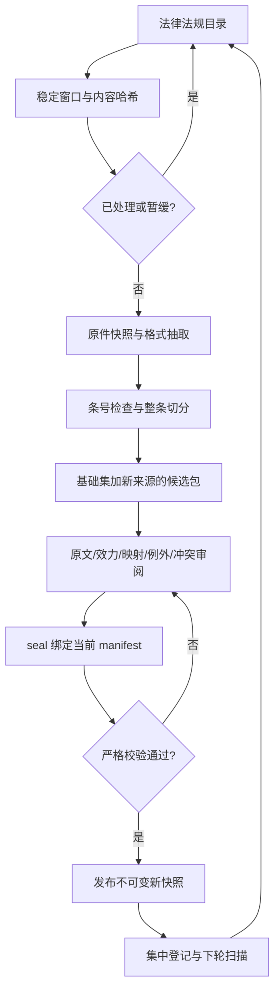

# P0 自动化流水线

P0 的原始实施记录见 `reports/p0-acceptance.md`。当前将一次性过程整理为持续运行的本地文件流水线，机器步骤自动推进，法律审阅保留明确门禁。

| P0 步骤 | 流水线行为 | 失败或未决行为 |
|---|---|---|
| P0-01 输入与环境 | 发现本地文件、识别扩展名、读取 SHA-256，记录实际抽取工具版本 | 不支持格式登记 unsupported；工具缺失登记 failed |
| P0-02 环境可复现 | 复用项目 .venv 和哈希锁定依赖；Windows 登录任务启动目录监视 | 安装命令见 README，不在每次投递时重新安装依赖 |
| P0-03 来源与抽取 | 等待内容稳定，复制原始字节，DOC/WPS、DOCX/XML、PDF/PyMuPDF、UTF-8 文本分别抽取 | 保留原件和失败原因；扫描 PDF 不猜测文字；保险法暂缓优先 |
| P0-04 切分与规则 | 检查连续条号、保留整条及例外、建立稳定 ID；复制已发布基础集并加入新来源形成候选包 | 新来源效力 unknown、规则与范围 pending_review，输出全文/规则审阅模板 |
| P0-05 校验与发布 | 审阅者完成原文、版本、规则和冲突检查后 seal；目录循环自动严格校验、发布新快照、更新集中登记 | 未审阅、未来生效、错误关联、哈希变化均阻止发布；旧版保留 |



## 日常使用

```powershell
# 后台启动（不弹出窗口）；默认每 5 秒检查一次
.\.venv\Scripts\python.exe -m insurance_audit.cli pipeline start
# 状态、一次扫描、失败版本重试、停止
.\.venv\Scripts\python.exe -m insurance_audit.cli pipeline status
.\.venv\Scripts\python.exe -m insurance_audit.cli pipeline run
.\.venv\Scripts\python.exe -m insurance_audit.cli pipeline run --retry
.\.venv\Scripts\python.exe -m insurance_audit.cli pipeline stop
# 当前用户登录后自动启动；移除时加 -Remove
.\scripts\install_pipeline_task.ps1
```

把新文件放入 `法律法规/`（也支持子目录）。默认需两次扫描观察到同一哈希，即稳定约 5 秒后处理。相同字节即使改名也只抽取一次；同名内容变化生成独立版本。失败内容不会每五秒重试，修复文件或显式 --retry 才再次执行。删除源文件不会删除历史快照。WPS 暂时不可用不会中断其他文件。

DOC 需要系统 `py -3.11` 能导入 pywin32 且安装 WPS，单次抽取超时 90 秒；只启动独立隐藏只读实例并禁用宏，不附着用户已打开的文档。DOCX 抽取正文段落/表格段落，页眉、脚注及复杂图形仍须在全文审阅时核对；扫描 PDF/OCR 不在当前自动抽取能力内。

## 集中记录与产物

- `data/extracted/extraction-registry.json`：唯一集中登记入口，documents 关联来源、实际/预期哈希、工具、抽取物、核对身份和快照；snapshots 列出各版本；pipeline 保存每个文件观察、内容版本、候选状态和续跑位置。
- `data/pipeline/sources/<完整SHA256>/`：字节快照、抽取 JSON、条文和来源元数据；审阅前同样保留追溯依据。
- `data/corpus/candidate-<摘要>/`：已发布基础集加本批新文件、完整条文/规则/范围台账、审阅模板和结构校验报告。新增文件不会自行成为已生效依据。
- `data/runtime/pipeline-health.json`：最近扫描、进程状态或错误；pipeline.log 记录进程启动失败；这些运行文件不入 Git。

## 审阅及自动续跑

1. 在候选包中核对新来源全文、版本、生效日期、标题和适用范围，填写 documents.jsonl；为新义务补充 rule_cards.jsonl。每个范围内条文必须有规则映射，范围外条文必须有理由。
2. 检查与基础集的修订/替代和冲突。默认候选保留旧来源，新文件不会按文件名自动替换旧法；若应替换，调整候选的来源/条文/规则/台账，使引用完整。全部规则集变化需要重新检查。
3. 以 review-template.json 为结构参考，完成 review.json：真实 reviewer.type/id、实际 method、所有来源哈希、条文原文哈希与已核对 scope、规则语义 digest。规则 digest 使用 `insurance_audit.corpus.review.semantic_digest`；模板的空 reviewer 和 pending_review 不能通过门禁。旧法规的 record_core_review.py 等一次性脚本已随 2026-10-12 清理删除，新法规审阅只使用 pipeline review-template 流程。
4. 执行 `pipeline seal --ruleset <候选ID>`：应用已完成的审阅记录，核对来源哈希，登记效力元信息，严格校验后生成绑定当前 manifest 哈希的 review-approval.json。
5. 后台循环发现 approval，自动重验并发布。批准后改动 manifest 会使批准失效；改动条文/规则会触发哈希或审阅不一致。发布后禁止原位覆盖。后台停用时可执行 pipeline run 续跑。

没有配置模型/可信审阅机制时，流程停在 needs_review 属于预期结果，不能自行伪造法律映射或法律专家签名。P0 自动发布表示知识库通过工程与审阅门禁，后续 P1/P3 的真实模型和效果评估仍按 PLAN 执行。

若两个候选基于同一旧版，先发布其中一个后，另一个会因基础版本变化而阻止发布，需合并新基础集并重新审阅；不允许静默丢弃先发布的新规则。运行态支持崩溃后重启、单实例锁、文件级错误隔离与人工触发重试。任务在用户登录期间运行，注销后等待下次登录恢复。

## 保留的原始约束

保险法仍为 extraction_deferred_by_user；指导意见 reference_only。调整 catalog 中这两个明确状态后才参与后续扫描。已发布三份核心法规及原文件一律保留。自动化不改变用户指定“本地文件为依据”的来源政策。
