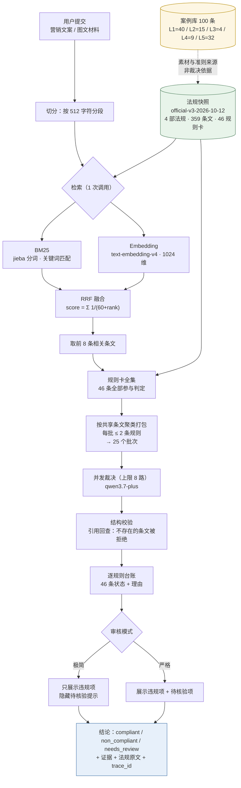

# 保宣合规助手 · 项目介绍（约 5 分钟讲稿）

> 所有数字均来自本仓库当前代码与实测记录，规则集 `official-v3-2026-10-12`。
> 文中标注「⚠️ 与初稿不同的地方」处，是对原始口述的更正。

---

## 一、开场：一句话说清这个项目

**保宣合规助手**把一段保险营销文案（或图文材料）送进系统，输出「是否违规、违反了哪一条、依据哪一条法规原文」的可追溯结论。

它替代的是人工逐条比对法规的流程。人工做这件事的成本在于：一次营销材料可能要对照数十条规则，每条都要回到法规原文确认，且结论必须能被复核。

---

## 二、业务边界：解决什么，不做什么

**解决的问题**：营销材料发出前的合规预检——在内容上线之前，找出有证据支持的违规项。

**明确不做的事**（这是系统设计的一部分，不是能力不足）：

| 不做 | 原因 |
|---|---|
| 不替代法律意见 | 规则卡由实施 agent 核对，**不代表法律专家认证**（`production_legal_certification: false`） |
| 不核验现实资质 | 机构牌照、代理人资格等外部事实不在材料内，系统只标注「需外部核验」 |
| 不做无依据的推断 | 材料信息不足时输出「需补充信息」，而不是猜一个结论 |
| 不把覆盖率当准确率 | 覆盖率是「检查了多少条」，不是「判对了多少条」 |

结论的适用范围被显式限定：**仅限当前规则集及已提交材料范围**。

---

## 三、数据与模型

### 3.1 数据：四部法规 + 一个案例库

**法规（裁决依据）**——`official-v3-2026-10-12` 快照：

| 法规 | 条文数 |
|---|---|
| 中华人民共和国保险法 | 187 |
| 保险销售行为管理办法 | 50 |
| 金融产品网络营销管理办法 | 39 |
| 互联网保险业务监管办法 | 83 |
| **合计** | **359 条文 / 46 条规则卡** |

**案例库（学习与评测参考，不是裁决依据）**——`保险营销违规案例库_100条.md`：

100 条记录分 5 层，**分层本身就说明了用途边界**：

| 层 | 数量 | 用途 |
|---|---|---|
| L1 违规案例（含逐字话术） | 40 | dev 主力素材 |
| L2 处罚摘要层 | 15 | 需复核候选，**禁止**提取「违规原句」 |
| L3 司法边界层 | 4 | 难例：「监管认定违规」≠「民法欺诈」 |
| L4 对抗与正面层 | 9 | 反例/对抗样本 |
| L5 监管规则与风险提示语料层 | 32 | 条款映射与判定准则语料，**不作个案样本** |

> ⚠️ **与初稿不同的地方**：案例库**不是**「100 条都拿来跑评测」。只有 L1（40 条）中完整性为 A/A− 的可直接加工成样本；L2 明确禁止提取违规原句；L5 根本不作为个案样本。案例库的作用是**素材与准则来源**，不是评测集本身。

### 3.2 数据可信度：为什么快照是哈希密封的

每条法规的原文、抽取结果、规则卡都记录 SHA-256，写入 `manifest.json`。应用启动时会重新校验，**任何字节不一致都会拒绝启动**。

已发布的快照**不可原位覆盖**。这也是为什么「把保险法挪到列表第一位」这件事，最终是新建了一个 `official-v3-2026-10-12` 快照，而不是改 v2 的文件——v2 的哈希已经绑定在历史结论上，改动它会破坏可复现性。

### 3.3 模型与供应商

| 用途 | 模型 |
|---|---|
| 文本裁决 | `qwen3.7-plus` |
| 图片理解 | `qwen3-vl-plus` |
| 向量检索 | `text-embedding-v4`（1024 维） |

供应商为阿里云百炼（DashScope）。**供应商可控性**体现在：接口是 OpenAI 兼容协议，替换供应商只需改 Base URL 与模型名；`AUDIT_MOCK=true` 可完全离线运行（用 MockProvider），用于无网络演示与测试。

### 3.4 法规入库：切分、分段与向量化

入库不是「把 PDF 丢进去」，而是一条**六步流水线**，每一步都有校验门禁：

| 步骤 | 做什么 | 产物 |
|---|---|---|
| 1. 来源登记 | 显式登记来源、状态、适用范围 | `data/sources/catalog.json` |
| 2. 原文抽取 | DOC 用 WPS COM，PDF 用 PyMuPDF | `data/extracted/*.paragraphs.json` / `.pages.json` |
| 3. **条文切分** | 按「第 N 条」标记正则切分 | `articles.jsonl` |
| 4. 哈希绑定 | 每个文件、每条条文算 SHA-256 | `manifest.json` |
| 5. 审阅映射 | 人工/agent 建立规则卡 | `rule_cards.jsonl` |
| 6. **向量化** | 359 条条文转 1024 维向量 | `data/indexes/<hash>.json` |

**第 3 步（切分）的细节**——这是文本处理的核心：

- 用正则 `^第[〇零一二三四五六七八九十百千]+条` 识别条文起点
- 章节标题（`第 X 章`）单独归入元数据，**不会混进上一条正文**
- 条号必须**从 1 连续递增**，缺号、重复、乱序都会直接报错（`parse_units` 里强制校验）
- 每条保留**来源定位**：DOC 记录段落序号，PDF 记录页码+行号
- PDF 还会过滤网页页脚（「手机扫一扫打开此页」等），但**保留"除外"条款**——过滤不能误删实质内容

切分粒度是**整条**，不做机械截断。当前最长条文 812 字符，上限设 2000；未来超长条文要求「建立保留父条关系的分款索引」，**而不是截断**。

> 关于 `chunks.jsonl`：它与 `articles.jsonl` 是 **1:1** 的（359 = 359，`chunk_id == article_id`），只用于校验「分块是否恰好覆盖条文全集」，**不参与检索**。当前 `chunker_version = whole-article-v1`，即整条索引。

**第 6 步（向量化）的细节**：

- 每条条文拼成一段文本再嵌入：`文档标题 + 章节 + 条号 + 原文`
- 用 `text-embedding-v4`，**1024 维**，每批最多 10 条（API 限制）
- 向量做 L2 归一化，检索时用余弦相似度
- 索引文件名 = `digest(meta)`，而 `meta` 含 `ruleset_hash`（manifest 哈希）→ **规则集一变，旧索引自动失效**，不可能被误用
- 索引 7.82 MB，写入时先写临时文件再原子改名，避免半成品被读取

**关键区分**：入库时向量化的是**整条条文**（359 个向量）；审核时向量化的是**用户材料**（按 512 字符切段）。两者在同一向量空间里算相似度。

### 3.5 46 条规则卡是怎么形成的

这是最需要说清楚的一点：**规则卡不是从法规自动生成的，而是人工/agent 逐条建立的映射**。

**为什么需要规则卡？** 法规是「法律语言」，营销材料是「宣传语言」。中间需要一个翻译层，把「第一百一十六条禁止欺骗投保人」翻译成机器可判定的条件。

**每张规则卡包含 22 个字段**，可分为四类：

| 类别 | 字段示例 | 作用 |
|---|---|---|
| **身份** | `rule_id`、`category`、`coverage_group` | 规则叫什么、属于哪类 |
| **法源** | `article_ids`（直接依据）、`supporting_article_ids`（辅助）、`document_status`、`valid_from/to` | 绑定到哪几条法规原文、何时有效 |
| **判定条件** | `trigger_conditions`、`exceptions`、`required_facts`、`checkability` | 什么情况触发、什么情况例外、需要哪些事实 |
| **适用范围** | `subject_scope`、`channel_scope`、`product_scope` | 对谁、在哪个渠道、什么产品适用 |

**46 条的实际分布**（实测）：

| 每条规则引用的条文数 | 规则数 |
|---|---|
| 1 条 | 18 |
| 2 条 | 10 |
| 3 条 | 8 |
| 4–8 条 | 10 |
| **合计** | **46** |

**溯源字段（诚实披露）**：

```
reviewer_type:      implementation_agent   （46/46）
verification_status: reviewed_source_mapping（46/46）
verified:           true                   （46/46）
```

即：**46 条全部由实施 agent 核对，不是法律专家认证**。`manifest.json` 里也明确写着 `production_legal_certification: false`。

**规则卡如何进入审核**：审核时**46 条全部参与判定**，不因检索结果而减少。RAG 只决定「哪些法规原文被送进 prompt」，不决定「哪些规则被检查」——这是防止漏检的关键设计。

---

## 四、系统链路：RAG、模型、工具各负责什么

### 4.1 为什么需要 RAG

359 条条文无法全部塞进一次调用。RAG 的作用是**从 359 条里挑出最相关的 8 条**送进模型，同时**规则卡全集仍然全部参与判定**——避免「没检索到就判合规」的漏检。

### 4.2 检索怎么做的（BM25 + Embedding + RRF）

这是初稿里没讲清楚的部分，展开说明：

**第一步：把材料切段。** 用户提交的文本按 512 字符切分，每一段独立检索。这样做是为了让长材料里靠后的内容也能被召回。

**第二步：两路并行召回。**

- **BM25（关键词路）**：中文分词（jieba）后做词频-逆文档频率打分。它擅长抓**精确术语**——比如材料里出现「保本保息」，能直接命中含该措辞的条文。
- **Embedding（语义路）**：把段落和 359 条条文都转成 1024 维向量，算余弦相似度。它擅长抓**换了个说法的同一件事**——比如材料说「稳赚不赔」，条文写「不得承诺收益」，字面不重合但语义接近。

**第三步：RRF 融合两路结果。**

两路各取前 8 名，然后用 **Reciprocal Rank Fusion** 合并：

```
score = Σ  1 / (60 + rank)
```

即每条条文在两路中的名次各贡献一个分数，名次越靠前分越高，`60` 是平滑常数（防止第一名权重过大）。两路都排前面的条文得分最高。最后取总分前 8 条。

> 这一步的价值：BM25 的强项是精确匹配、弱项是同义改写；Embedding 正好相反。RRF 让**任一路的强项都能把条文顶上来的**，比单路更稳。

**第四步：向量索引是预构建的。** 359 条条文的向量在发布快照时一次性算好，存成 `data/indexes/<hash>.json`。索引文件名绑定 manifest 哈希，**规则集一变，旧索引自动失效**，不会被误用。

### 4.3 46 条规则怎么比对：并发多少次、检索多少次

这是初稿里需要确认的数字。实测结果：

| 项目 | 数值 |
|---|---|
| 规则总数 | 46 |
| 每次调用的规则数上限 | 2（`BATCH_RULE_COUNT=2`） |
| **裁决调用次数** | **25 次** |
| 并发度 | 8（`MODEL_CONCURRENCY=8`） |
| **检索调用次数** | **1 次**（Embedding 批量） |
| 单次审核总调用 | **26 次** |

所以：

- **检索只发生 1 次**（一次批量 embedding 调用，内部按每批 10 条切分）。
- **裁决发生 25 次**，不是 46 次——因为规则被**按共享条文聚类后打包**，共享同一条法规原文的规则合并到同一次调用，避免同一段法条重复传输。
- 25 次调用**不是串行执行**，而是 `asyncio.gather` **并发发起，并发上限 8**。所以实际是「25 次调用、8 路并发」。

> ⚠️ **与初稿不同的地方**：不是「46 条规则串行检索 46 次」。是 **1 次检索 + 25 次裁决调用（8 路并发）**。而且 25 这个数字来自聚类打包，会随规则集内容变化。

**为什么上限是 2 条规则？** 这是实测的取舍。批量越大，单次输出的 token 越多，而**延迟由输出 token 数主导**（约 60 token/秒），不是由输入长度主导。实测：上限 8 → 116 秒，上限 4 → 51 秒，上限 2 → 36 秒。所以选择小批量换取低延迟。

### 4.4 工具与人工的分工

| 角色 | 负责 |
|---|---|
| RAG | 从 359 条中召回相关条文 |
| 模型 | 判断每条规则是否被触发，并给出证据与引用 |
| 确定性代码 | 哈希校验、预算控制、结构校验、覆盖率统计 |
| **人工** | 规则卡的制定与核对、案例库标注、发布审批 |

**关键设计**：模型只负责「判断」，不负责「引用是否真实」。模型输出的条文引用会被代码回查——引用不存在的条文会被拒绝并要求重试。

---

## 五、评测与上线

### 5.1 当前评测状态（诚实披露）

| 指标 | 现状 |
|---|---|
| 开发集样本 | 5 条（目标 20） |
| 测试集样本 | 0 条（目标 40） |
| 标注状态 | `provisional`（临时，非专家 gold） |
| 正式效果评估 | **未完成** |

**已有的验证**：G1/G2 合成开发案例工程验收通过（验证链路可用，不证明准确率）。多模型对比：`qwen3.7-plus` 5/5、`qwen-plus` 4/5、`qwen-turbo` 3/5，失败均为教育反例误复核。

> ⚠️ **与初稿不同的地方**：初稿说「反复修改 Prompt，使 100 条案例结果与行政处罚公文结果相同」。**这一步没有完成**。案例库是素材来源，标注状态是 provisional，正式评测集尚未建立。已做的是用少量开发样本迭代 Prompt 与规则卡。这个区别很重要——把未完成的事讲成已完成，正是这个项目要避免的「把目标当已实现能力」。

### 5.2 什么指标算通过

- **覆盖率**：`已检查 / 应检查`。开发集实测 0%–70%（中位约 69%），取决于材料。**覆盖率不是准确率**。注意 `eligible=0` 时比值为 `null`，表示当前材料没有可判定的规则。
- **误报/漏报**：需要人工标注的测试集才能算，尚未建立。
- **三态结论**：`compliant` / `non_compliant` / `needs_review`。**`needs_review` 不算失败**，它表示材料信息不足。

### 5.3 渐进上线与回滚

**上线**：Docker Compose 部署到阿里云 ECS，Caddy 自动签发 HTTPS。GitHub Actions 在 push 后跑测试，通过则 SSH 到服务器 `git pull` + 重新构建。

**回滚**：规则集是版本化的快照，回滚只需改 `RULESET_ID` 指向旧快照并重启。旧快照完整保留，历史结论可复现。

**部署门禁**：workflow 会比较 `.env` 与 `.env.example` 的 `RULESET_ID`，不一致直接失败——防止服务器静默使用旧规则集。

---

## 六、风险治理：可验证、可审核、可追溯、可干预

| 要求 | 实现方式 |
|---|---|
| **可验证** | 每条违规必须附「营销材料证据」+「法规原文」；引用不存在的条文会被代码拒绝 |
| **可审核** | 输出逐规则台账：46 条规则每一条的状态（已检查/不适用/需补充信息/需外部核验/执行失败/范围外）与理由 |
| **可追溯** | 每次审核返回 `trace_id`；`meta` 记录规则集哈希、Prompt 版本、检索到的条文、每次调用的耗时与 token |
| **可干预** | 审核模式可选（极简/严格）；材料不足时输出「需补充信息」而非猜测；`needs_review` 与「违规」严格区分 |

### 两种审核模式

| 模式 | 行为 |
|---|---|
| **极简 · 只报违规** | 隐藏「待核验」提示，只显示违规项。**但这些提示仍然参与结论判定**，只是不展示 |
| **严格 · 含待核验项** | 全部显示，包括「需补充信息」的提醒 |

> ⚠️ **与初稿不同的地方**：极简模式**不是**「不检查待核验项」，而是「检查了但不展示」。两种模式的违规结论、状态、判定**完全一致**，差别只在展示。响应里的 `meta.hidden_review_items` 会报告被隐藏了多少条。

### 隐私

图片仅在单次请求内处理，原文不写运行日志（`LOG_CONTENT=false`）。API 默认开放访问，无 token。

---

## 七、一句话收尾

这个项目的核心不是「用大模型判合规」，而是**把大模型的判断约束在可验证的边界内**：结论必须有法规原文支撑，覆盖范围必须显式披露，未完成的能力必须标注为未完成。

---

## 附：端到端流程图


流程图已单独成页，在线地址：**https://baoxuanzhushou.app/workflow**

该页由 [src/insurance_audit/static/workflow.html](../../src/insurance_audit/static/workflow.html) 提供，用内联 SVG 渲染（无 JS、无 CDN 依赖，CSP 无需放宽）。

### 图注

- **实线** = 运行时链路；**虚线** = 离线素材来源（案例库不参与裁决）
- **绿色** = 哈希密封的不可变快照（应用启动时校验，不一致则拒绝启动）
- **黄色** = 案例库，标注状态 `provisional`
- **蓝色** = 最终结论
- 检索 **1 次**，裁决 **25 次**（8 路并发），单次审核共 **26 次调用**。批次数取决于检索到的条文集合，因此会随材料变化。
